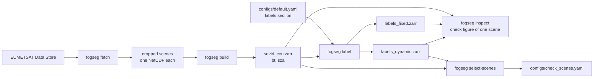

# Night-time fog detection from Meteosat SEVIRI

[](https://github.com/muhammettcepi/seviri-fog-segmentation/actions/workflows/ci.yml)

Segmenting fog and low stratus at night from Meteosat SEVIRI infrared imagery over Central Europe:
a physics-based baseline (the 10.8 − 3.9 µm brightness temperature difference), weak labels derived
from it, a small U-Net trained on them, and an evaluation of both against independent airport
visibility observations (METAR).

> **Status: work in progress.** Data access, preprocessing and weak labels work; the model and the
> evaluation against METAR are next.


*7 November 2024, 05:00 UTC, dynamic labels. Top left: the Night Microphysics RGB, where fog and low
cloud are pale yellow-green. Top right: the labels over it, with fog in cyan and ignored pixels
hatched (the eastern part is twilight). Bottom left: the BTD histogram with the threshold used.
A dense low-stratus deck lay over almost all of Germany that morning
([Donnerwetter.de, 7 Nov 2024](https://www.donnerwetter.de/wetter-aktuell/wenig-wind-wolken-und-kuehle-temperaturen_cid_110468.html)),
and the labels cover it (92.9 % of the decided pixels in a box over Germany are fog, while 21 % of the box is
ignored, see [`label_check.md`](docs/notes/label_check.md)). This night is from the **test season**: it was looked at only after all
thresholds were fixed and never used to set one. It shows how the labels behave, it does not
measure their accuracy. Contains modified EUMETSAT Meteosat SEVIRI data (2024-25).*

## Why this works at night

Small water droplets emit less efficiently at 3.9 µm than at 10.8 µm. At night, the brightness
temperature difference BTD = BT(10.8) − BT(3.9) is therefore higher over fog and low stratus than
over the ground. A warm cloud top (high BT 10.8) tells us the cloud is low. During the day,
reflected sunlight at 3.9 µm hides this signal, so the project is night-only.

Clear ground does not sit at zero. For the uncorrected difference used here, the 3.9 µm band
overlaps CO₂ absorption and land emits less well at 3.9 µm, so clear ground has a positive BTD.
On the 304 night scenes of the training season its peak is at a median of 3.6 K, and it moves
from night to night (1.9 to 4.6 K between the 1st and 99th percentile); low cloud is at about
5 to 8 K. A single fixed threshold cannot follow that, so the labels can compare each scene with
its own clear-ground level. The measurements are in
[`docs/notes/btd_exploration.md`](docs/notes/btd_exploration.md).

## Fog labels

Every pixel of every scene gets one of three labels: `1` fog or low stratus, `0` not fog, `255`
ignore (twilight, missing data, or too close to the threshold to call). A pixel is fog if its BTD
is above a threshold, its cloud top is warm, it is not thin cirrus and the top is smooth; small
patches and the pixels within 0.5 K of the threshold (on either side) are ignored. Two modes exist:

- `fixed`: the threshold is 5.0 K for every scene.
- `dynamic` (the default): the threshold is the scene's clear-ground peak plus 1.5 K, and 5.0 K
  when no peak can be found.

A clean training-season example, with two humps in the histogram and the threshold between them, is
[29 February 2024, 03:00 UTC](docs/notes/figures/check_20240229T0300_dynamic.png).

The rule, the thresholds, and per-season statistics are in the
[dataset card](docs/DATASET_CARD.md#labels). How the thresholds were measured is in
[`docs/notes/btd_exploration.md`](docs/notes/btd_exploration.md); how the labels were checked by eye on
15 training-season scenes, and why `dynamic` became the default, is in
[`docs/notes/label_check.md`](docs/notes/label_check.md).

These are **weak labels**: a rule on satellite data, not an observation on the ground. A satellite
sees cloud tops, so fog and low stratus cannot be told apart, and fog under higher cloud is
labelled `0`. Airport visibility observations (METAR) will be used to judge and tune the labels.

## How the parts fit together



## What exists so far

| Part | Where |
|---|---|
| Access a first scene with `eumdac` + `satpy` (Colab how-to) | [`notebooks/01_access_seviri_data.ipynb`](notebooks/01_access_seviri_data.ipynb) |
| Resumable bulk download → crop → small NetCDF per scene | `fogseg fetch` ([`src/fogseg/cli.py`](src/fogseg/cli.py)) |
| Quick access test (token, search, 1 KB download) | `fogseg check` |
| Stack all scenes into one ML-ready Zarr store | `fogseg build` ([`src/fogseg/build.py`](src/fogseg/build.py)) |
| Where clear ground and low cloud sit in the BTD, and the thresholds measured from it | [`notebooks/02_explore_btd.ipynb`](notebooks/02_explore_btd.ipynb), [`docs/notes/btd_exploration.md`](docs/notes/btd_exploration.md) |
| Weak fog labels (`0` / `1` / `255`), one Zarr store per mode, `fixed` or `dynamic` threshold | `fogseg label` ([`src/fogseg/label_store.py`](src/fogseg/label_store.py), [`labels.py`](src/fogseg/labels.py), [`dynamic_threshold.py`](src/fogseg/dynamic_threshold.py)) |
| Check figure of one scene: RGB, labels, BTD histogram, solar zenith angle | `fogseg inspect` ([`src/fogseg/inspect.py`](src/fogseg/inspect.py)) |
| Pick the 15 training-season scenes to check by eye, with a fixed rule | `fogseg select-scenes` → [`configs/check_scenes.yaml`](configs/check_scenes.yaml) |
| The visual check of the labels and why `dynamic` is the default | [`docs/notes/label_check.md`](docs/notes/label_check.md) |
| All settings (region, channels, seasons, night slots, label thresholds, paths) | [`configs/default.yaml`](configs/default.yaml) |
| Tests on tiny synthetic scenes (no data or credentials needed) | `pytest` ([`tests/`](tests/)) |

Dataset: 608 night scenes (two fog seasons, Oct–Feb 2023/24 and 2024/25, 4 slots per night,
every second night), 8 IR channels on SEVIRI's native grid, cropped to 2–20°E, 43–55°N
(241 × 462 pixels), with per-pixel solar zenith angle and lat/lon. The labels are stored next to
it. See the [dataset card](docs/DATASET_CARD.md).

## Quickstart (Linux / WSL)

```bash
python3 -m venv .venv && source .venv/bin/activate
pip install -e .

# EUMETSAT API consumer key + secret (https://api.eumetsat.int/api-key); never commit them
read -s EUMETSAT_KEY && read -s EUMETSAT_SECRET && export EUMETSAT_KEY EUMETSAT_SECRET

fogseg check                          # can we log in, search and download?
fogseg fetch --dry-run                # how many scenes would be fetched
fogseg fetch --workers 2              # download + crop all scenes (resumable)
fogseg build                          # stack them into one Zarr store

fogseg label                          # labels_<mode>.zarr; mode = labels.mode in the config (dynamic)
fogseg label --mode fixed             # the fixed-threshold version; --overwrite replaces a store
fogseg select-scenes                  # write configs/check_scenes.yaml (uses labels.mode, or --labels)
fogseg inspect --time 2024-02-29T03:00 --labels dynamic   # one check figure, a PNG in labels.figures_dir

pip install -e ".[dev]" && pytest     # run the tests
```

Paths in `configs/default.yaml` point to `/mnt/d/...` (a Windows D: drive seen from WSL); change
them for your machine. Satellite data is never committed to this repository.

## Branches, CI and releases

`main` is the production branch: only released code lands there. Day-to-day work goes into
`develop` through pull requests from feature branches (`feature/...`, `ci/...`).

Every push to `main` or `develop` and every pull request runs `ruff`, `pytest` on Python 3.11–3.13,
and a package build ([`.github/workflows/ci.yml`](.github/workflows/ci.yml)). To release, bump
`version` in `pyproject.toml` on `develop`, merge `develop` into `main`, and tag the result on `main`:

```bash
git switch main && git pull && git tag v0.2.0 && git push origin v0.2.0
```

[`release.yml`](.github/workflows/release.yml) then checks the tag is on `main` and matches the
version, reruns CI, publishes the package to PyPI and creates a GitHub Release with the built files.

## Data

Meteosat SEVIRI Level 1.5 data (`EO:EUM:DAT:MSG:HRSEVIRI`) from the EUMETSAT Data Store, used under
the EUMETSAT data licence. Downloading requires a free EUMETSAT account with the licences accepted. Figures in this repository contain modified EUMETSAT Meteosat SEVIRI data.

## License

Code: [MIT](LICENSE).
