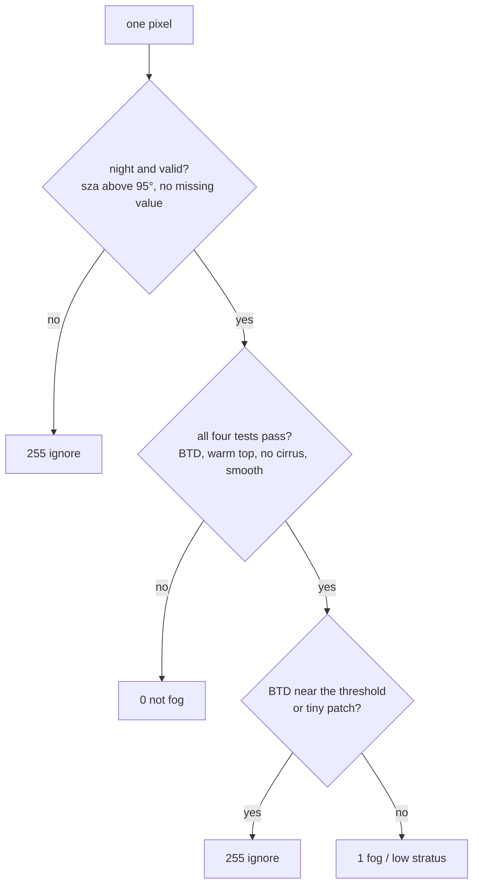

# Dataset card: SEVIRI night-time IR, Central Europe

An ML-ready stack of Meteosat SEVIRI infrared brightness temperatures for night-time fog and low
stratus detection. Built with `fogseg fetch` (download + crop) and `fogseg build` (stack into Zarr).
Weak fog / low-stratus labels for every scene are made with `fogseg label` and described in
[Labels](#labels).

## Summary

| | |
|---|---|
| Format | Zarr v3 store, `seviri_ceu.zarr` (803 MB on disk) |
| Main variable | `bt` (time, channel, y, x) = (608, 8, 241, 462), float32, Kelvin |
| Other variables | `sza` (time, y, x) solar zenith angle in degrees, at the time the region was scanned; `platform`, `source_file` per scene |
| Coordinates | `time` (UTC, nominal start of the 15-minute repeat cycle), `channel` + `wavelength` (µm), `y`/`x` (metres, geostationary projection), `lat`/`lon` (y, x) |
| Chunks | 8 scenes per chunk (~28 MB of `bt` uncompressed) |
| Source | EUMETSAT Data Store, `EO:EUM:DAT:MSG:HRSEVIRI` (SEVIRI Level 1.5, 0° service) |
| Satellite | Meteosat-10 (MSG-3) for all 608 scenes |
| Built with | `fogseg` 0.1.0, satpy reader `seviri_l1b_native`, `calibration="brightness_temperature"` |

Open it with:

```python
import xarray as xr

ds = xr.open_zarr("seviri_ceu.zarr", consolidated=False)
```

The numeric arrays use core Zarr v3 data types. The two text variables (`platform`,
`source_file`) use zarr-python's fixed-length UTF-32 string type, an extension that non-Python
Zarr readers may not support. The store has no consolidated metadata (not part of the v3 standard).

## Spatial coverage

- Region of interest: 2–20°E, 43–55°N (Benelux, France, Germany, Switzerland, Austria, Czechia,
  Poland, northern Italy): fog hotspots such as the Po Valley, the Swiss Plateau and the North German Plain.
- Grid: SEVIRI's **native geostationary grid**, cropped, **not resampled**, so there are no
  interpolation artefacts. Every scene has exactly the same pixels (checked during the build).
- The crop is the smallest rectangle *in the satellite projection* that contains the region, so its
  corners reach a little further: latitude 42.6–56.1°N, longitude 1.6–27.4°E.
- Pixel size is ~3 km at the sub-satellite point, but over Central Europe the slanted view makes
  pixels ~3.3 km east–west × ~5.8 km north–south (medians; up to 4.1 × 8.6 km in the far
  north-east corner).
- Row 0 is the northern edge, column 0 the western edge (`upper_right_corner="NE"`).

## Temporal coverage

| | |
|---|---|
| Seasons | 2023-24 (1 Oct 2023 – 29 Feb 2024) and 2024-25 (1 Oct 2024 – 28 Feb 2025): 304 scenes each |
| Nights | every second night |
| Slots (UTC) | 21:00, 00:00, 03:00, 05:00: 152 scenes each |
| Range | 2023-10-01 21:00 → 2025-03-01 05:00 |

**Intended split (by time, never random):** train on 2023-24 (with a held-out validation block,
e.g. February 2024), test on 2024-25. Neighbouring scenes of one night are nearly identical, so a
random split would leak test information into training.

## Channels

| channel | λ (µm) | mean (K) | std (K) | min (K) | max (K) |
|---|---|---|---|---|---|
| IR_039 | 3.9 | 259.78 | 13.09 | 204.8 | 290.3 |
| WV_062 | 6.2 | 230.17 | 5.58 | 200.7 | 250.4 |
| WV_073 | 7.3 | 244.81 | 9.48 | 201.3 | 267.9 |
| IR_087 | 8.7 | 259.24 | 14.81 | 201.3 | 290.8 |
| IR_097 | 9.7 | 238.48 | 8.89 | 208.3 | 264.9 |
| IR_108 | 10.8 | 260.76 | 15.80 | 200.7 | 293.7 |
| IR_120 | 12.0 | 259.78 | 16.21 | 199.0 | 292.9 |
| IR_134 | 13.4 | 245.11 | 10.84 | 200.6 | 268.1 |

Statistics over all 608 scenes and all pixels. They are descriptive only; the model's
normalisation must be computed on the **training season only**.

The four solar channels (VIS006, VIS008, IR_016, HRV) are left out: they carry no signal at night.

## Quality notes

- **Invalid values:** 1,238 values (0.0002 % of `bt`), all in IR_039, were ~0 K and are set to
  NaN. They occur under very cold cloud tops (IR_108 ≈ 210 K), where the 3.9 µm signal is below
  the instrument noise. These pixels are deep convective cloud, never fog. Threshold: < 150 K.
- **Scan time vs. `time`:** `time` is the nominal start of the repeat cycle (e.g. 05:00:00).
  SEVIRI scans from south to north, so Central Europe is observed 10.7–11.5 minutes later. `sza`
  is computed at `time` plus the scan delay of the middle of the region (11.1 minutes, derived from
  the grid), which keeps its error below ~0.1°. Using the nominal time instead would
  **overestimate** it by up to ~2° in the 05:00 scenes (the sun is rising), letting twilight
  pixels pass the night mask.
- **Twilight at 05:00 UTC:** 13.3 % of pixels in the 05:00 scenes have a solar zenith angle of
  95° or less (minimum 83.1°, early October and late February, eastern part of the region).
  Reflected sunlight contaminates IR_039 there; use `sza > 95` as a night mask. All 21:00, 00:00
  and 03:00 pixels are night; 96.7 % of all pixels are night.
- **BTD convention:** the fog signal used in this project is the **uncorrected** difference
  `IR_108 − IR_039`. satpy's `night_fog` composite applies a CO₂ correction to IR_039 that shifts
  this difference by ~5 K over low cloud; we follow the EUMETSAT Night Microphysics recipe instead.

## Labels

Weak labels for fog and low stratus, made by `fogseg label` from the dataset above. There is one
Zarr store per mode, next to the dataset: `labels_fixed.zarr` and `labels_dynamic.zarr` (folder
`labels.output_dir` in [`configs/default.yaml`](../configs/default.yaml)). They have the same
`time`, `y` and `x` as the dataset, so `xr.merge([dataset, labels])` lines them up. The default mode
is `dynamic`.

| Value | Meaning |
|---|---|
| `1` | fog or low stratus, visible from space |
| `0` | not fog / low stratus |
| `255` | ignore: data not trustworthy (twilight, missing values) or too uncertain to call; the loss skips it |

| Variable | Dimensions | Content |
|---|---|---|
| `label` | time, y, x | `uint8`: `0`, `1` or `255` |
| `btd_threshold` | time | BTD threshold used for the scene (K) |
| `threshold_source` | time | `fixed`, `dynamic` or `fallback` |
| `fog_fraction` | time | share of the **decided** pixels (label 0 or 1, not 255) that are `1`; NaN if a scene has none |
| `ignore_fraction` | time | share of **all** pixels that are `255` |

The store attributes hold the mode, every threshold used, the `fogseg` version and the source
dataset, so a store explains itself.

### The rule



1. **Trust.** A pixel is `255` if the solar zenith angle is 95° or less (reflected sunlight in
   IR_039) or if IR_039, IR_108 or IR_120 is missing.
2. **Four tests.** A trusted pixel is a fog candidate only if it passes all of them:

   | Test | Rule |
   |---|---|
   | Water droplets | `IR_108 − IR_039` above the BTD threshold |
   | Low cloud | `IR_108` at least 255 K |
   | Not thin cirrus | `IR_108 − IR_120` below 1.5 K |
   | Smooth top | standard deviation of `IR_108` in a 3 × 3 window below 1.5 K |

3. **Cleanup.** A candidate whose BTD is less than 0.5 K above the threshold becomes `255`, and so
   does a candidate in a group of fewer than 5 connected pixels (about 100 km² here), since a small
   patch can be real valley fog.
4. **Everything else** that is trusted becomes `0`.

All values are in the `labels` section of [`configs/default.yaml`](../configs/default.yaml): `night_min_sza`
95.0, `warm_min_bt108` 255.0, `cirrus_max_split` 1.5, `smooth_max_std` 1.5, `uncertainty_band` 0.5,
`min_blob_pixels` 5, `btd_fixed` 5.0. They were measured on the 2023-24 training season only
([`docs/notes/btd_exploration.md`](notes/btd_exploration.md)); the 2024-25 season was not used to set any of them.

### The BTD threshold

- **`fixed` mode:** 5.0 K (`btd_fixed`) in every scene.
- **`dynamic` mode:** clear ground has a BTD peak of its own in each scene, and it moves from night to
  night (1.9 to 4.6 K, 1st to 99th percentile in the training season). Per scene, the BTD of
  the trusted, warm, non-cirrus pixels is put in a histogram (bins of 0.25 K from −2 to 8 K, smoothed over
  3 bins). The clear-ground peak is its highest bin inside the window 1.5 to 4.75 K, and the
  threshold is that peak plus 1.5 K, the distance at which the valley between clear ground and low
  cloud lay in the training season. The result is limited to 3.5 to 6.0 K.
  The scene falls back to the fixed 5.0 K (`threshold_source = fallback`) if the histogram has fewer
  than 2,000 pixels or the highest bin is at the edge of the window, so no real peak was found.

### Label statistics

Computed from the stores on the 304 scenes of each season (a night belongs to the season in which it
starts, so the morning slots after midnight count with the night before). "Mean fog fraction" is the
mean over scenes of `fog_fraction`, "mean ignore fraction" the mean of `ignore_fraction`.

| Mode | Season | Mean fog fraction | Mean ignore fraction | Dynamic threshold | Fallback to 5.0 K |
|---|---|---|---|---|---|
| fixed | 2023-24 (training) | 0.0508 | 0.0618 | – | – |
| fixed | 2024-25 (test) | 0.1194 | 0.0793 | – | – |
| dynamic | 2023-24 (training) | 0.0537 | 0.0601 | 293 scenes | 11 scenes |
| dynamic | 2024-25 (test) | 0.1302 | 0.0778 | 288 scenes | 16 scenes |

In the training season the dynamic threshold has a median of 5.1 K (middle half 4.6 to 5.4 K,
range 3.5 to 5.9 K; [btd_exploration](notes/btd_exploration.md)). Fog is a small class: about 5 %
of the decided pixels in the training season, about 13 % in the test season, so the class balance
differs between the two. The test-season numbers describe the labels only; nothing was tuned on them.

### How the labels were checked

15 training-season scenes were looked at by eye, in both modes, before any model was trained; the
choice of `dynamic` as the default and the decision to keep every threshold as measured are in
[`docs/notes/label_check.md`](notes/label_check.md). The scenes are listed in
[`configs/check_scenes.yaml`](../configs/check_scenes.yaml). This is a visual check of gross mistakes,
not a measure of accuracy.

### Limitations

- **Weak labels are not ground truth.** They come from a rule on satellite data. Airport visibility
  observations (METAR) will be used later to judge and tune them.
- **Fog under higher cloud gets `0`**, not `255`. The satellite sees only the top, so a model
  trained on these labels learns that fog is absent under thick cloud; that is a property of the
  data, not of the weather.
- **Fog and low stratus cannot be told apart** from space. `1` means a low water-cloud deck that may or may not
  touch the ground.
- **Snow-covered ground** can look like low cloud in some of the tests. The check scenes were
  not chosen to include snow, so this has not been examined.
- **A low-cloud deck inside the clear-ground window.** If a deck covers most of the region and its BTD
  is only slightly above the ground, the dynamic method may take the deck for clear ground and set the
  threshold too high (for example 21 November 2023, 00:00). There is no cloud mask to decide this.
- **Mild nights fall back to 5.0 K**, only about 0.3 to 0.4 K above the ground peak there, so some
  clear ground or thin cloud may be labelled as fog (11 of 304 training scenes; both modes give the
  same label there).
- **The viewing-angle drift is not corrected.** The clear-ground BTD rises by about 1 K from 54° to
  65.5° viewing angle, which in this region means from south to north (the two are almost the
  same thing, so the effect is mixed with surface type and air temperature). Nothing obvious showed
  in the check scenes, but without a cloud mask this cannot be proved.

## What this dataset is not

- **Not ground truth.** The labels are a physical rule, not observations; see the limitations above.
- **Fog vs. low stratus:** the satellite sees cloud tops. It cannot tell whether a low cloud touches
  the ground; that is checked separately against airport visibility (METAR).
- **Not redistributed.** The data are EUMETSAT data used under the EUMETSAT data licence; this
  repository contains the code to rebuild the dataset, not the data itself.

## Reproduce

```bash
fogseg fetch --workers 2     # 608 scenes, ~4-8 h, resumable (needs a EUMETSAT API key)
fogseg build                 # ~1-3 min
fogseg label --mode fixed    # labels_fixed.zarr
fogseg label --mode dynamic  # labels_dynamic.zarr
```
