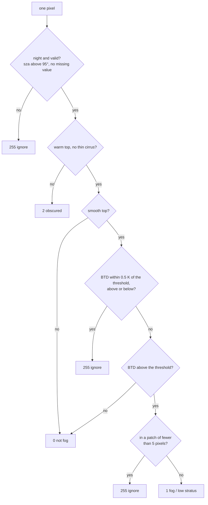

# Dataset card: SEVIRI night-time IR, Central Europe

An ML-ready stack of Meteosat SEVIRI infrared brightness temperatures for night-time fog and low
stratus detection. Built with `fogseg fetch` (download + crop) and `fogseg build` (stack into Zarr).
Weak fog / low-stratus labels for every scene are made with `fogseg label` and described in
[Labels](#labels).

## Summary

| | |
|---|---|
| Format | Zarr v3 store, `seviri_ceu.zarr` (803 MB on disk) |
| Main variable | `bt` (time, channel, y, x) = (608, 8, 241, 462), float32, Kelvin |
| Other variables | `sza` (time, y, x) solar zenith angle in degrees, at the time the region was scanned; `platform`, `source_file` per scene |
| Coordinates | `time` (UTC, nominal start of the 15-minute repeat cycle), `channel` + `wavelength` (µm), `y`/`x` (metres, geostationary projection), `lat`/`lon` (y, x) |
| Chunks | 8 scenes per chunk (~28 MB of `bt` uncompressed) |
| Source | EUMETSAT Data Store, `EO:EUM:DAT:MSG:HRSEVIRI` (SEVIRI Level 1.5, 0° service) |
| Satellite | Meteosat-10 (MSG-3) for all 608 scenes |
| Built with | `fogseg` 0.1.0, satpy reader `seviri_l1b_native`, `calibration="brightness_temperature"` |

Open it with:

```python
import xarray as xr

ds = xr.open_zarr("seviri_ceu.zarr", consolidated=False)
```

The numeric arrays use core Zarr v3 data types. The two text variables (`platform`,
`source_file`) use zarr-python's fixed-length UTF-32 string type, an extension that non-Python
Zarr readers may not support. The store has no consolidated metadata (not part of the v3 standard).

## Spatial coverage

- Region of interest: 2–20°E, 43–55°N (Benelux, France, Germany, Switzerland, Austria, Czechia,
  Poland, northern Italy): fog hotspots such as the Po Valley, the Swiss Plateau and the North German Plain.
- Grid: SEVIRI's **native geostationary grid**, cropped, **not resampled**, so there are no
  interpolation artefacts. Every scene has exactly the same pixels (checked during the build).
- The crop is the smallest rectangle *in the satellite projection* that contains the region, so its
  corners reach a little further: latitude 42.6–56.1°N, longitude 1.6–27.4°E.
- Pixel size is ~3 km at the sub-satellite point, but over Central Europe the slanted view makes
  pixels ~3.3 km east–west × ~5.8 km north–south (medians; up to 4.1 × 8.6 km in the far
  north-east corner).
- Row 0 is the northern edge, column 0 the western edge (`upper_right_corner="NE"`).

## Temporal coverage

| | |
|---|---|
| Seasons | 2023-24 (1 Oct 2023 – 29 Feb 2024) and 2024-25 (1 Oct 2024 – 28 Feb 2025): 304 scenes each |
| Nights | every second night |
| Slots (UTC) | 21:00, 00:00, 03:00, 05:00: 152 scenes each |
| Range | 2023-10-01 21:00 → 2025-03-01 05:00 |

**Intended split (by time, never random):** train on 2023-24 (with a held-out validation block,
e.g. February 2024), test on 2024-25. Neighbouring scenes of one night are nearly identical, so a
random split would leak test information into training.

## Channels

| channel | λ (µm) | mean (K) | std (K) | min (K) | max (K) |
|---|---|---|---|---|---|
| IR_039 | 3.9 | 259.78 | 13.09 | 204.8 | 290.3 |
| WV_062 | 6.2 | 230.17 | 5.58 | 200.7 | 250.4 |
| WV_073 | 7.3 | 244.81 | 9.48 | 201.3 | 267.9 |
| IR_087 | 8.7 | 259.24 | 14.81 | 201.3 | 290.8 |
| IR_097 | 9.7 | 238.48 | 8.89 | 208.3 | 264.9 |
| IR_108 | 10.8 | 260.76 | 15.80 | 200.7 | 293.7 |
| IR_120 | 12.0 | 259.78 | 16.21 | 199.0 | 292.9 |
| IR_134 | 13.4 | 245.11 | 10.84 | 200.6 | 268.1 |

Statistics over all 608 scenes and all pixels. They are descriptive only; the model's
normalisation must be computed on the **training season only**.

The four solar channels (VIS006, VIS008, IR_016, HRV) are left out: they carry no signal at night.

## Quality notes

- **Invalid values:** 1,238 values (0.0002 % of `bt`), all in IR_039, were ~0 K and are set to
  NaN. They occur under very cold cloud tops (IR_108 ≈ 210 K), where the 3.9 µm signal is below
  the instrument noise. These pixels are deep convective cloud, never fog. Threshold: < 150 K.
- **Scan time vs. `time`:** `time` is the nominal start of the repeat cycle (e.g. 05:00:00).
  SEVIRI scans from south to north, so Central Europe is observed 10.7–11.5 minutes later. `sza`
  is computed at `time` plus the scan delay of the middle of the region (11.1 minutes, derived from
  the grid), which keeps its error below ~0.1°. Using the nominal time instead would
  **overestimate** it by up to ~2° in the 05:00 scenes (the sun is rising), letting twilight
  pixels pass the night mask.
- **Twilight at 05:00 UTC:** 13.3 % of pixels in the 05:00 scenes have a solar zenith angle of
  95° or less (minimum 83.1°, early October and late February, eastern part of the region).
  Reflected sunlight contaminates IR_039 there; use `sza > 95` as a night mask. All 21:00, 00:00
  and 03:00 pixels are night; 96.7 % of all pixels are night.
- **BTD convention:** the fog signal used in this project is the **uncorrected** difference
  `IR_108 − IR_039`. satpy's `night_fog` composite applies a CO₂ correction to IR_039 that shifts
  this difference by ~5 K over low cloud; we follow the EUMETSAT Night Microphysics recipe instead.

## Labels

Weak labels for fog and low stratus, made by `fogseg label` from the dataset above. There is one
Zarr store per mode, next to the dataset: `labels_fixed.zarr` and `labels_dynamic.zarr` from the rule, and
`labels_teacher.zarr` from the station-trained teacher ([below](#teacher-labels-the-training-labels)) (folder
`labels.output_dir` in [`configs/default.yaml`](../configs/default.yaml)). They have the same
`time`, `y` and `x` as the dataset, so `xr.merge([dataset, labels])` lines them up. The configured mode
is `teacher`; the rule's stages (`diagnose`, `experiment`, `teacher`) always study `fixed`.

| Value | Meaning |
|---|---|
| `1` | fog or low stratus, visible from space |
| `0` | not fog / low stratus |
| `2` | obscured: a higher or thin cirrus cloud hides what is below; neither fog nor clear |
| `255` | ignore: data not trustworthy (twilight, missing values) or too uncertain to call; the loss skips it |

| Variable | Dimensions | Content |
|---|---|---|
| `label` | time, y, x | `uint8`: `0`, `1`, `2` or `255` |
| `btd_threshold` | time | BTD threshold used for the scene (K) |
| `threshold_source` | time | `fixed`, `dynamic` or `fallback` |
| `fog_fraction` | time | share of the **decided** pixels (label 0 or 1; not 2 and not 255) that are `1`; NaN if a scene has none |
| `ignore_fraction` | time | share of **all** pixels that are `255` |
| `obscured_fraction` | time | share of **all** pixels that are `2` |

The store attributes hold the mode, every threshold used, the `fogseg` version and the source
dataset, so a store explains itself.

### The rule



1. **Trust.** A pixel is `255` if the solar zenith angle is 95° or less (reflected sunlight in
   IR_039) or if IR_039, IR_108 or IR_120 is missing.
2. **Three tests besides the BTD.** A trusted pixel can only be fog if it passes all of them:

   | Test | Rule | If it fails |
   |---|---|---|
   | Low cloud | `IR_108` at least 255 K | `2` obscured |
   | Not thin cirrus | `IR_108 − IR_120` below 1.5 K | `2` obscured |
   | Smooth top | standard deviation of `IR_108` in a 3 × 3 window below 1.5 K | `0` |

   A cold top or thin cirrus may hide fog underneath, so the pixel is neither fog nor clear: it is `2`,
   obscured. A rough top over warm ground is `0`.

3. **BTD against the threshold** (water droplets), for the pixels that passed step 2. If `IR_108 − IR_039`
   is within 0.5 K of the BTD threshold, **on either side**, the pixel is too uncertain and becomes `255`.
   Above the threshold plus 0.5 K it is a fog candidate; below the threshold minus 0.5 K it is `0`.
4. **Small patches.** A fog candidate in a group of fewer than 5 connected pixels (about 100 km² here)
   becomes `255`, since a small patch can be real valley fog. The groups are counted on the candidates
   that are left after step 3.
5. **Everything else** that is trusted becomes `0`.

All values are in the `labels` section of [`configs/default.yaml`](../configs/default.yaml): `night_min_sza`
95.0, `warm_min_bt108` 255.0, `cirrus_max_split` 1.5, `smooth_max_std` 1.5, `uncertainty_band` 0.5,
`min_blob_pixels` 5, `btd_fixed` 4.0. They were measured on the 2023-24 training season only
([`docs/notes/btd_exploration.md`](notes/btd_exploration.md)); `btd_fixed` was then tuned against station
observations of the same season ([`docs/notes/station_validation.md`](notes/station_validation.md)). The 2024-25
season was not used to set any of them.

### The BTD threshold

- **`fixed` mode:** 4.0 K (`btd_fixed`) in every scene. Tuned against 1175 stations in the training season; it
  replaced 5.0 K, which missed most of the fog.
- **`dynamic` mode:** clear ground has a BTD peak of its own in each scene, and it moves from night to
  night (1.9 to 4.6 K, 1st to 99th percentile in the training season). Per scene, the BTD of
  the trusted, warm, non-cirrus pixels is put in a histogram (bins of 0.25 K from −2 to 8 K, smoothed over
  3 bins). The clear-ground peak is its highest bin inside the window 1.5 to 4.75 K, and the
  threshold is that peak plus 1.5 K, the distance at which the valley between clear ground and low
  cloud lay in the training season. The result is limited to 3.5 to 6.0 K; with the current window the upper limit is never reached, because the
  highest accepted peak is 4.375 K, so the highest threshold is 5.875 K.
  The scene falls back to `btd_fixed`, 4.0 K (`threshold_source = fallback`), if the histogram has fewer
  than 2,000 pixels inside its range of -2 to 8 K or the highest bin is at the edge of the window, so no real peak was found.

### Label statistics

Computed from the stores on the 304 scenes of each season (a night belongs to the season in which it
starts, so the morning slots after midnight count with the night before). "Mean fog fraction" is the
mean over scenes of `fog_fraction`, "mean ignore fraction" the mean of `ignore_fraction`.

| Mode | Season | Mean fog fraction | Mean ignore fraction | Mean obscured fraction | Dynamic threshold | Fallback to 4.0 K |
|---|---|---|---|---|---|---|
| fixed | 2023-24 (training) | 0.2574 | 0.1464 | 0.4639 | – | – |
| fixed | 2024-25 (test) | 0.3614 | 0.1619 | 0.3248 | – | – |
| dynamic | 2023-24 (training) | 0.1159 | 0.0904 | 0.4639 | 293 scenes | 11 scenes |
| dynamic | 2024-25 (test) | 0.2116 | 0.1194 | 0.3248 | 288 scenes | 16 scenes |

In the training season the dynamic threshold has a median of 5.1 K (middle half 4.6 to 5.4 K,
range 3.5 to 5.9 K; [btd_exploration](notes/btd_exploration.md)), so the dynamic labels mark much
less fog than the fixed 4.0 K. Almost half of the pixels in the training season are obscured (`2`), the same in both
modes, since the obscured tests do not depend on the threshold. The fog fraction counts only the decided pixels (`0`
and `1`); with the obscured pixels out of that count it is about 26 % in the training season and 36 % in the test
season (fixed labels), so the class balance differs between the two. Before the obscured class, when those pixels
were `0`, the same labels gave 13 % and 24 %. The ignore fraction is higher with 4.0 K than it was with 5.0 K
(0.146 against 0.096 in the training season), because the 0.5 K band on either side of the threshold now lies where many
pixels are. The test-season numbers describe the labels only; nothing was tuned on them.

### How the labels were checked

15 training-season scenes were looked at by eye, in both modes, before any model was trained
([`docs/notes/label_check.md`](notes/label_check.md); the scenes are listed in
[`configs/check_scenes.yaml`](../configs/check_scenes.yaml)). That check chose `dynamic` at first.

The labels were then scored against 1175 airport (METAR) and weather stations (SYNOP)
([`docs/notes/station_validation.md`](notes/station_validation.md)). A report counts as fog or low stratus when
visibility is below 1 km or a broken or overcast deck has its base below 1 km. For the cases the satellite can see:

| Labels | Season | POD | FAR | CSI (95 % interval) |
|---|---|---|---|---|
| `dynamic`, peak + 1.5 K, fallback 5.0 K (before) | 2023-24 (training) | 0.27 | 0.19 | 0.26 (0.20–0.32) |
| `fixed`, 4.0 K (now the default) | 2023-24 (training) | 0.50 | 0.28 | 0.42 (0.37–0.47) |
| `fixed`, 4.0 K | 2024-25 (test, scored once) | 0.70 | 0.19 | 0.60 (0.55–0.64) |

The threshold was chosen on the Heidke and Peirce skill scores. CSI alone peaks at 3.5 K (0.44), but at 3.5 K far more
clear ground is labelled fog. The test season scores higher because it had more widespread low stratus and less fog
under high cloud, not because the labels changed; the details are in the note.

Work on better labels ([`docs/notes/better_labels.md`](notes/better_labels.md)) scores the training season on a
held-out set of nights and stations, and with the **full count**, in which an ignored pixel under a fog report is a
miss. By that count the fixed 4.0 K labels have POD 0.43 and FAR 0.25 on the held-out cases (0.40 and 0.28 on all
cases).

The `labels` section also has options for other versions of the rule: `texture` (the smoothness test, or none),
`fog_index` (the BTD or the 3.9 µm emissivity index), `split_window` (`fixed` or the KMA line) and `temporal_relax`
(a near miss next to fog in the slot before or after becomes fog). Their defaults give the rule above. The best
combination (no smoothness test, the emissivity index at 0.80, a 0.5 K relax) gained 0.04 POD at a lower FAR on the
held-out cases, but the 95 % interval of the gain reached below zero, so it did not replace the default.

### Teacher labels (the training labels)

`fogseg label --mode teacher` writes a third store, `labels_teacher.zarr`, with a per-pixel classifier trained on the
station truth instead of a rule. It was written as a benchmark; the owner then chose it as the **training labels of the
U-Net**, so `labels.mode` is now `teacher`.
The store has `label`, with the same values as above, and one more variable:

| Variable | Dimensions | Content |
|---|---|---|
| `label` | time, y, x | `uint8`: `0`, `1`, `2` or `255` |
| `fog_probability` | time, y, x | `uint8`: round(p × 250), so 0 to 250 for p from 0 to 1; `255` where p is undefined (untrusted pixel, no ERA5 when that group is used, or obscured) |

`label` is `1` where p is above p* = 0.41 by more than 0.1 and `0` where it is below p* by more than 0.1. Untrusted
pixels are `255` and obscured pixels `2`, as in the rule; `255` also marks the band of ±0.1 around p*. No local
correction is applied. The store attributes hold the setting, p*, the half-width, the feature groups, the model path, the
scikit-learn version and the label options.

How it was made: a histogram-based gradient boosting classifier (learning rate 0.05, 31 leaves) on 27 features (the
brightness temperatures, their differences, texture, geometry, terrain, time and the rule label; **no ERA5**, the ERA5
store was not built), trained on the visible station cases of the selection nights and stations of the 2023-24 season
and calibrated with isotonic regression; p* is where the out-of-fold FAR is 0.28. On the held-out nights and stations
(full count) it has POD 0.769 at FAR 0.266, against 0.433 and 0.255 for the fixed 4.0 K rule. It was not kept as the
default because its FAR is 0.011 higher, which the pre-registered keep rule does not allow; the owner then switched.
On stations it has not seen, POD is 0.722 against the rule's 0.366, so the gain is not only a learned fog rate per
location. The geometry and terrain features can learn such rates, so a model scored on stations that fed this teacher
would not be a clean test. Details are in [`docs/notes/better_labels.md`](notes/better_labels.md#phase-c-station-trained-teacher).

Share of all pixels, 608 scenes:

| Store | 0 | 1 | 2 | 255 | Fog among decided |
|---|---|---|---|---|---|
| `labels_fixed` (the rule) | 0.301 | 0.151 | 0.394 | 0.154 | 0.334 |
| `labels_teacher` (configured, the U-Net's training labels) | 0.279 | 0.215 | 0.394 | 0.112 | 0.436 |

7.9 % of all pixels are in the teacher's ignore band. The obscured share is the same by construction.

### U-Net predictions

`fogseg predict` writes `predictions_unet.zarr` (path `unet.predictions_path`) in the layout of the teacher store:
`label` and `fog_probability`, as above, plus `fog_fraction`, `ignore_fraction` and `obscured_fraction`. It holds the
304 scenes of the training season only; the test season needs `--final`. `label` is `1` where the U-Net's p is at or
above p* = 0.40, `0` below, `255` at untrusted pixels and `2` where the rule says obscured. There is no ignore band. The
store attributes hold the setting, p*, the model path and its sha256, the torch version and the label options. `fogseg
evaluate` refuses a store that was not made by the current model file. The model, its training and its scores are in
[`docs/notes/unet.md`](notes/unet.md).

Share of all pixels, the 304 scenes of 2023-24:

| Store | 0 | 1 | 2 | 255 | Fog among decided |
|---|---|---|---|---|---|
| `labels_fixed` | 0.285 | 0.105 | 0.464 | 0.146 | 0.270 |
| `labels_teacher` | 0.260 | 0.172 | 0.464 | 0.105 | 0.398 |
| `predictions_unet` | 0.300 | 0.202 | 0.464 | 0.034 | 0.402 |

### Limitations

- **Weak labels are not ground truth.** They come from a rule on satellite data. Against stations they
  find half of the visible fog and low stratus (POD 0.50), and 28 % of what they call fog is not (FAR).
- **Fog under higher cloud is labelled `2` (obscured)**, neither fog nor clear. 51 % of the fog or
  low-stratus reports in the training season lie under a pixel that fails the high-cloud tests. The
  satellite sees only the top, so an IR-only label cannot see fog under thick cloud; it can only mark
  that the view is blocked. A model that treats `2` as `0` learns that there is no fog under cloud.
- **Fog and low stratus cannot be told apart** from space. `1` means a low water-cloud deck that may or may not
  touch the ground.
- **Snow-covered ground** can look like low cloud in some of the tests. The check scenes were
  not chosen to include snow, so this has not been examined.
- **A low-cloud deck inside the clear-ground window.** If a deck covers most of the region and its BTD
  is only slightly above the ground, the dynamic method may take the deck for clear ground and set the
  threshold too high (for example 21 November 2023, 00:00). There is no cloud mask to decide this.
- **Fallback nights (dynamic mode).** When the histogram peak lies at the upper edge of the window,
  that hump is usually a low-cloud deck, not clear ground. The stations confirm it: on those scenes
  the old fallback of 5.0 K had CSI 0.30, the new 4.0 K has 0.59. This affects 11 of 304 training scenes
  and 16 of 304 test scenes.
- **The viewing-angle drift is not corrected.** The clear-ground BTD rises by about 1 K from 54° to
  65.5° viewing angle, which in this region means from south to north (the two are almost the
  same thing, so the effect is mixed with surface type and air temperature). The stations confirm
  it: at cloud-free stations the median BTD is 3.0 K in 43–47° N and 3.8 to 3.9 K in 51–56° N. With
  one threshold for the whole region, 26 % of the cloud-free reports in 51–56° N are labelled fog,
  against 5 % in 43–47° N.
- **Many reported fog cases look like clear ground** in the BTD. At the station pixels, fog becomes
  more likely than clear ground only about 0.5 K above the threshold. 60 % of the missed visible fog
  fails the smoothness test (broken or patchy decks). No threshold separates these.

## What this dataset is not

- **Not ground truth.** The labels are a physical rule, not observations; see the limitations above.
- **Fog vs. low stratus:** the satellite sees cloud tops. It cannot tell whether a low cloud touches
  the ground: against visibility below 1 km alone, 92 % of the labelled fog is not ground fog.
- **Not redistributed.** The data are EUMETSAT data used under the EUMETSAT data licence; this
  repository contains the code to rebuild the dataset, not the data itself.

## Auxiliary data

Two stores on the same grid, used to check and later to improve the labels; neither goes into the labels yet.

| Store | Command | Source | Content |
|---|---|---|---|
| `dem_ceu.zarr` | `fogseg dem` | Copernicus DEM GLO-90, public AWS bucket `copernicus-dem-90m` | `elevation_mean`, `elevation_std` per pixel (m), from the 90 m tiles inside each pixel |
| `era5_ceu.zarr` | `fogseg era5` | ERA5 hourly single levels, Copernicus Climate Data Store | 2 m temperature, skin temperature, 2 m dewpoint, snow depth at each scene time, bilinear to the grid |

- Copernicus DEM: © DLR e.V. 2010–2014 and © Airbus Defence and Space GmbH 2014–2018, provided under COPERNICUS by
  the European Union and ESA; all rights reserved. GLO-90 is free to use under its licence.
- ERA5: contains modified Copernicus Climate Change Service information. Downloading needs a free CDS account, the
  dataset licence accepted on its CDS page, and the key in `~/.cdsapirc`; the code never reads or prints the key.
- ERA5 has 0.25° cells (about 20 × 28 km here), coarse for valley fog. It is a feature, not truth.

## Reproduce

```bash
fogseg fetch --workers 2     # 608 scenes, ~4-8 h, resumable (needs a EUMETSAT API key)
fogseg build                 # ~1-3 min
fogseg label --mode fixed    # labels_fixed.zarr
fogseg label --mode dynamic  # labels_dynamic.zarr
fogseg stations              # station reports for the check; SYNOP takes many hours (Ogimet rate limit)
fogseg dem                   # dem_ceu.zarr, ~3 min
fogseg era5                  # era5_ceu.zarr (needs ~/.cdsapirc)
fogseg split                 # held-out nights and stations of the training season, once
fogseg validate --season 2023-24
fogseg diagnose              # why visible fog is missed, selection cases only
fogseg experiment --phase B  # label variants, cross-validated on the selection cases
fogseg teacher               # phase C: the station-trained model, processed/teacher.joblib
fogseg label --mode teacher  # labels_teacher.zarr, ~5 min
fogseg train                 # the U-Net, processed/unet.pt (needs pip install -e ".[model]")
fogseg predict               # predictions_unet.zarr, training season
fogseg evaluate              # the held-out comparison, once
```
