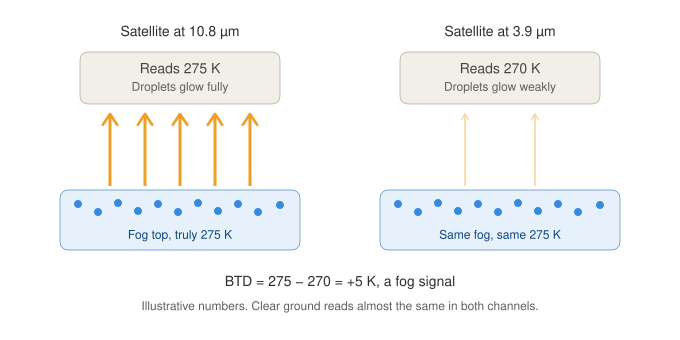
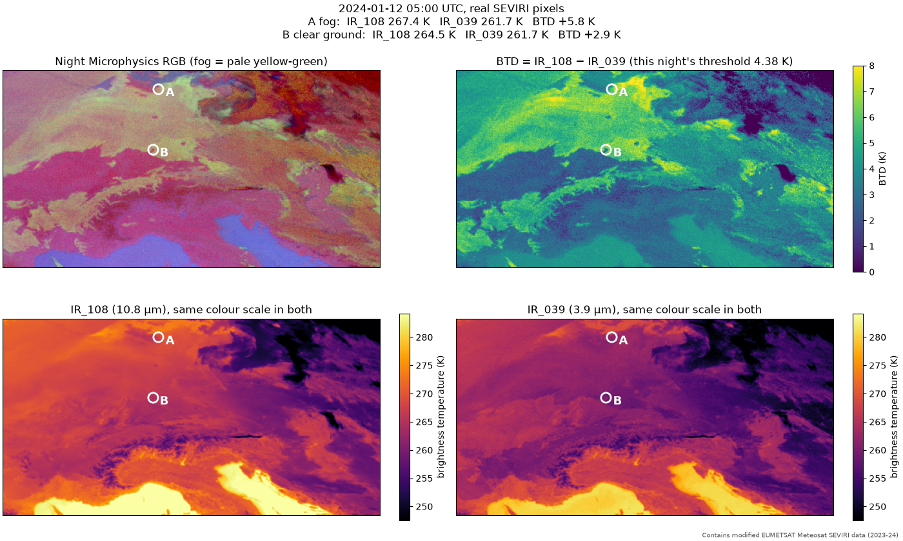

# How a satellite sees fog at night

The fog labels rest on one number per pixel, the brightness temperature difference
`BTD = IR_108 − IR_039`. This page explains what the channels are, why the difference shows fog,
and what the two extra tests (thin cirrus and ice) look at, with one real night from our data.

## Channels and brightness temperature

SEVIRI takes the same picture in twelve "colours" of light at once. The ones we use are infrared,
invisible to the eye, and the channel name gives the wavelength:

| Channel | Wavelength | Used for |
|---|---|---|
| `IR_039` | 3.9 µm | the fog signal (with `IR_108`) |
| `IR_087` | 8.7 µm | the ice test, only in the exploration notebook |
| `IR_108` | 10.8 µm | the fog signal, the warm-top test |
| `IR_120` | 12.0 µm | the thin-cirrus test (with `IR_108`) |

Everything warm glows in the infrared. The value stored for a pixel is its **brightness
temperature**: how warm the pixel *looks* in that colour. Ground, water droplets and ice crystals
glow slightly differently in different colours, so one channel says "how warm", and the
**difference between two channels** says **what the material is**.

## Why fog shows up in the BTD

A fog deck has one real temperature, but the two channels read different values:

- At **10.8 µm** the small water droplets glow almost perfectly, so the satellite reads the true
  temperature of the fog top.
- At **3.9 µm** they glow weakly: water absorbs less there, and tiny droplets scatter part of the
  light instead of emitting it. The satellite reads a **colder** value.

How well something glows compared with a perfect emitter is its **emissivity**: for fog about 1
at 10.8 µm and clearly less at 3.9 µm. A thermal camera shows the same effect in a kitchen: a shiny
steel pan and a matt black pot at the same temperature, and the shiny pan looks colder because it
emits less. At 3.9 µm fog behaves like the shiny pan.

So `IR_108 − IR_039` is **large for fog** and **small for clear ground**.

- **Night only.** By day the 3.9 µm channel also catches reflected sunlight, which swamps the
  signal. That is why the labels need the sun more than 95° from the zenith.
- **Clear ground is not at 0 K.** Land glows a little less at 3.9 µm, and gases (CO₂, water vapour)
  absorb part of the 3.9 µm light on its way up. On our data clear ground sits at about **+3.6 K**
  and moves from night to night; see [`docs/notes/btd_exploration.md`](../notes/btd_exploration.md).

## A real night: 12 January 2024, 05:00 UTC

Two pixels, chosen from the dynamic labels: A is a typical fog pixel (the median BTD of the fog
pixels), B a clear-ground pixel inland, closest to this night's ground level.

| Pixel | `IR_108` | `IR_039` | BTD | Label |
|---|---|---|---|---|
| A, fog, northern Germany (53.8° N, 11.4° E) | 267.4 K | 261.7 K | **+5.8 K** | fog |
| B, clear ground near Würzburg (49.6° N, 9.9° E) | 264.5 K | 261.7 K | **+2.9 K** | no fog |

This night's threshold is 4.38 K (clear-ground peak 2.88 K plus the 1.5 K offset).

- The two bottom panels share one colour scale: the fog deck around A is bright at 10.8 µm and
  clearly darker at 3.9 µm. B changes much less.
- The BTD panel is the left one minus the right one: the deck is yellow-green, the ground blue.
- The green colour of the Night Microphysics RGB *is* this BTD, which is why fog looks pale
  yellow-green there.
- At 10.8 µm the fog (267 K) is **warmer** than the clear ground (264 K). On calm winter nights clear
  ground cools fast, and fog lies under a lid of warmer air. One channel alone cannot tell fog from
  ground; the difference between two can.

The figure is drawn by [`make_fog_signal_figure.py`](make_fog_signal_figure.py).

## The thin-cirrus test: `IR_108 − IR_120`

10.8 and 12.0 µm lie close together in a part of the spectrum where the air is nearly transparent,
the "split window".

- Clear ground, thick cloud and fog read almost the same in both: a difference of about 0 to 1 K.
- Thin ice cloud (cirrus) is like a net curtain in front of a heater. Ice blocks 12.0 µm light more
  than 10.8 µm light, so the 10.8 µm channel sees more of the warm ground behind it and the
  12.0 µm channel more of the cold curtain: a difference of about 2 to 8 K.

A pixel with a difference of 1.5 K or more is looking through a curtain; its BTD is a mix of
the cirrus and whatever lies below, so the rule does not call it fog. On our data low cloud has
a median split of 0.2 K and thin cirrus 3.75 K. The red colour of the Night Microphysics RGB is
this difference, which is why thin cirrus looks dark red there.

Fog can lie *under* cirrus, invisible to the satellite. Such pixels get 0 (not fog), not 255
(ignore); the METAR comparison will show whether that costs much.

## The ice test: `IR_087 − IR_108`

Ice and liquid water absorb differently between 8.7 and 10.8 µm. For ice cloud the difference is
positive; for water cloud, fog and clear ground it is negative (water vapour also absorbs a little
at 8.7 µm). The labels do not use this test. The exploration notebook uses it to find "surely water
cloud" and "surely thin ice" pixels independently of the split window, so the cirrus limit could
be measured without choosing its pixels with the same limit.

## Is the BTD a standard method?

The idea is decades old and used operationally; the thresholds are not universal.

- The sign differs between papers: some use `IR_039 − IR_108`, where fog is negative. We use
  `IR_108 − IR_039`, like the Night Microphysics RGB.
- Thresholds depend on the instrument, the region and the season, which is why ours were measured on
  the 2023-24 training season instead of copied.
- Ours is uncorrected: no correction for viewing angle or atmosphere, so the clear-ground level drifts
  by about 1 K from south to north of our region.

## Sources

- Eyre, J. R., Brownscombe, J. L. & Allam, R. J. (1984): Detection of fog at night using Advanced Very
  High Resolution Radiometer (AVHRR) imagery. *Meteorological Magazine* 113, 266–271. The night fog
  difference on AVHRR.
- Inoue, T. (1985): On the temperature and effective emissivity determination of semi-transparent
  cirrus clouds by bi-spectral measurements in the 10 µm window region. *J. Meteor. Soc. Japan* 63,
  88–99. The split window for thin cirrus.
- Strabala, K. I., Ackerman, S. A. & Menzel, W. P. (1994): Cloud properties inferred from 8–12-µm
  data. *J. Appl. Meteor.* 33, 212–229. The 8.7 µm ice test.
- Ellrod, G. P. (1995): Advances in the detection and analysis of fog at night using GOES
  multispectral infrared imagery. *Weather and Forecasting* 10, 606–619. The operational GOES fog
  product.
- Cermak, J. & Bendix, J. (2007): Dynamical nighttime fog/low stratus detection based on Meteosat
  SEVIRI data: a feasibility study. *Pure and Applied Geophysics* 164, 1179–1192. The method on SEVIRI.
- EUMeTrain, Night Microphysics RGB: <https://resources.eumetrain.org/data/4/410/print_4.htm>. A
  readable guide to the colours and the differences behind them.

## In one sentence

"Small water droplets emit less at 3.9 µm than at 10.8 µm, so at night the difference between the
two channels picks out fog; the physics carries over between satellites, the thresholds do not, so
I measured them on SEVIRI data for my region and season."
