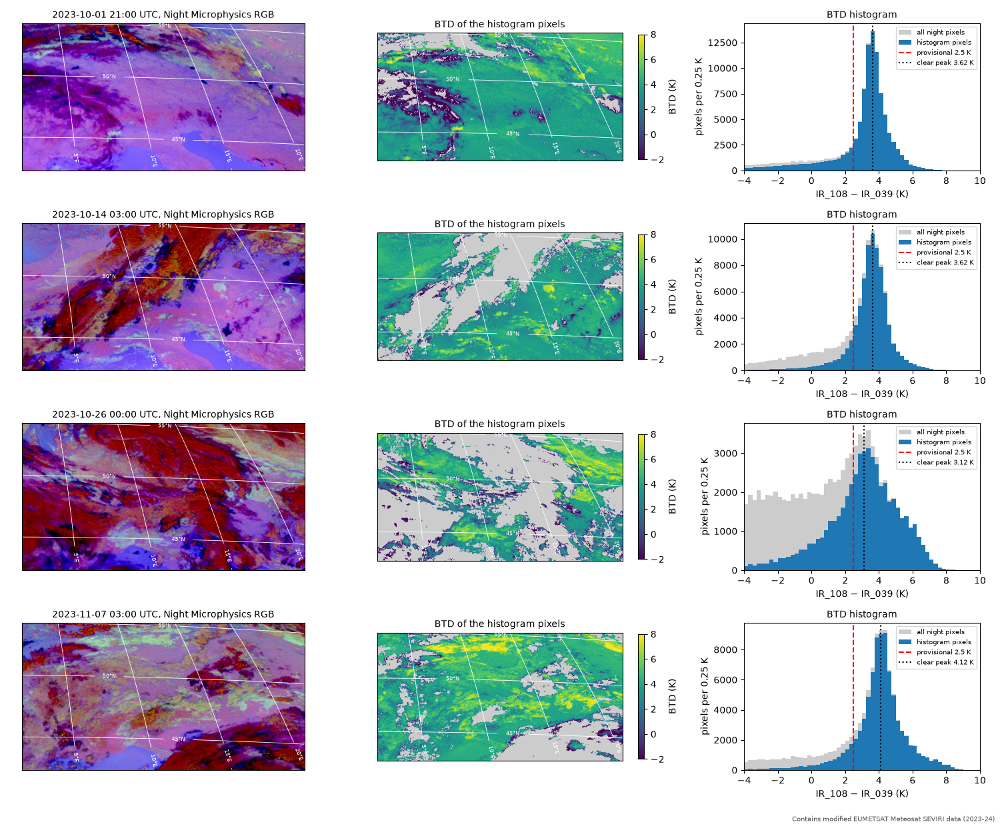
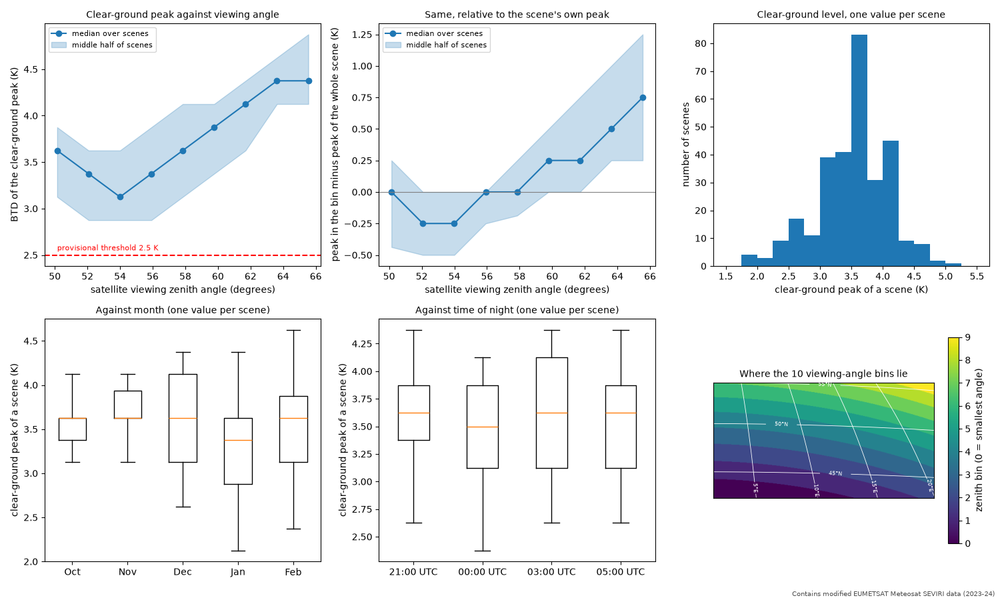
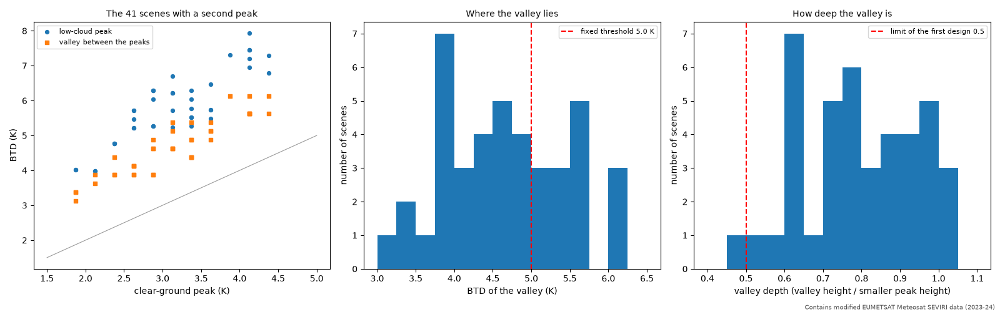
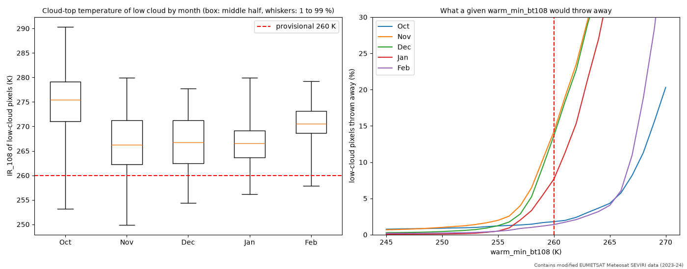
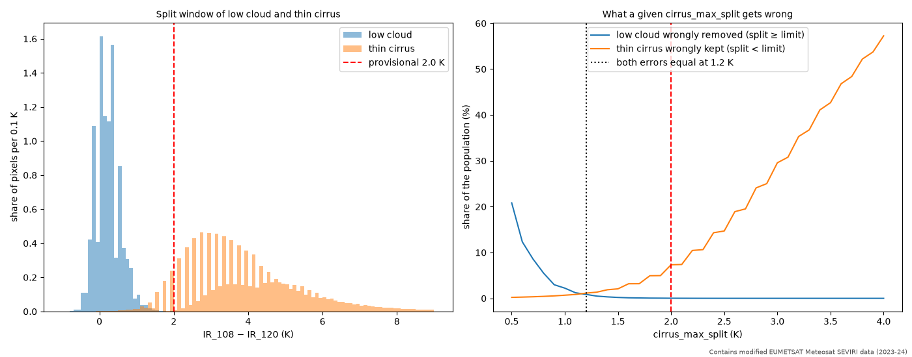
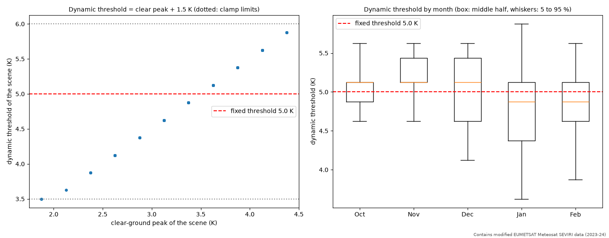

# Measuring the fog label thresholds: what the BTD looks like on real SEVIRI data

Notebook: [`notebooks/02_explore_btd.ipynb`](../../notebooks/02_explore_btd.ipynb) (all numbers and figures come from it).
Helper code: `src/fogseg/explore.py`. Settings: `configs/default.yaml`, section `labels`.

## The question

The fog labels test the brightness temperature difference `BTD = IR_108 - IR_039` (uncorrected, no CO2 correction).
Low water cloud has a high BTD, clear ground a low one. The first thresholds (fog if BTD > 2.5 K, low-cloud top at
least 260 K, cirrus if `IR_108 - IR_120` is 2.0 K or more) were guesses made before looking at the histograms.
Where do clear ground and low cloud really sit, and how much do they move?

## Data

Only the **training season 2023-24**: 304 night scenes (every second night, 21, 00, 03 and 05 UTC), 241 x 462 pixels
over central Europe. The 2024-25 season is the test set and was not used. Night means a solar zenith angle above
95 degrees. 12 varied scenes were inspected by eye next to their Night Microphysics RGB (picked by a deterministic
function, including the fog night of 21 November 2023); the rest of the numbers use all 304 scenes.

(More scenes: `figures/scene_overview_2.png`, `figures/scene_overview_3.png`.)

## Findings

**1. Clear ground is at about +3.6 K, not at 0 K or +2 K, and it moves from scene to scene.**
In every viewed scene one hump dominates the histogram, and the RGB shows it is clear ground. Over all scenes the
peak of that hump has median 3.6 K, middle half 3.1 to 3.9 K, 1st to 99th percentile 1.9 to 4.6 K. Cold nights in
January and February are the lowest (1.9 to 2.4 K, e.g. 22 January 2024); on those nights the old 2.5 K threshold sits
right on the clear-ground peak. Month and time of night matter little (medians within 0.25 K). The peak does not depend
on how much cold or cirrus cloud covers the scene (median 3.4 to 3.6 K in all groups). That does *not* show that a
low-cloud deck cannot pass for clear ground: such a deck is warm and counts as a histogram pixel, and there is no cloud
mask to tell them apart (see the open risks).

**2. Low cloud is a shoulder on the clear-ground hump, not a second hump, so the valley method fails.**
Low cloud sits at about 5 to 8 K, but it covers only part of a scene and its BTD varies from deck to deck. Only 41 of
303 scenes (mostly January and February) have a second peak, and the valley between the two is shallow (median depth
0.78, where the first design needed 0.5 or less). The first dynamic threshold, a valley between two humps, finds a valley
in **0 of 304 scenes** (1 with windows made from the measurements, 41 if the depth test is dropped; the notebook rebuilds
the rules of the first design to count this, with the agreed pixels for the last two). Separately, 41 of 303 scenes
(listed in the notebook as the "two-hump scenes", counted with the first-guess pixels) have a second peak at least 1.5 K
above the clear one; the two groups are different sets (different pixels and rules) and share 30 scenes. In the two-hump scenes the
valley lies about **1.5 K above the clear-ground peak**: median 1.5 K, standard deviation 0.32 K, range 1.0 to 2.25 K.
These scenes are mostly from January and February,
with a mean clear peak of 3.1 K against 3.5 K over the whole season, so the offset comes from a subset that may not
represent the rest. The clear-ground peak itself is found in 303 of 304 scenes.

**3. The viewing angle shifts clear ground by about +1 K, but we did not correct for it.**
Relative to the scene's own clear-ground peak, the peak in a viewing-angle bin goes from about -0.25 K at 54 degrees
to +0.75 K at 65.5 degrees, about 1 K in all (a straight-line fit over 50 to 65.5 degrees gives +0.063 K per degree),
more than the month or time of night. The angle and the latitude are almost the same thing in this region (correlation 0.96), so
surface type and air temperature are mixed in, and in the south (below 54 degrees) the trend is not monotonic. With
this much confounding, a correction would be a guess. The check scenes will show whether it is needed (see risks).

**4. Warm tops and cirrus.**
Low-cloud tops (night, smooth, BTD at least 5.5 K, no ice signature in `IR_087 - IR_108`) are colder in November to
January: at BTD of at least 5.5 K the 1st percentile of `IR_108` is 250 to 256 K. A limit of 260 K would throw away 14 % of the low cloud in
November and December, 255 K at most 2 % in any month for low cloud with BTD of at least 5.5 K (2.3 % in November
for BTD of at least 5.0 K). For cirrus, low cloud has `IR_108 - IR_120` of 0.2 K (median, 99 % below 1.2 K), thin cirrus
(ice signature, still warmer than 250 K) 3.75 K (median; 5 % below 1.9 K, 1 % below 1.15 K). A limit of 1.5 K removes
0.2 % of the low cloud and keeps 2.1 % of the cirrus; the old 2.0 K would keep 7.3 % of it.

## Agreed values

| Setting | Old (guess) | Agreed | Evidence |
|---|---|---|---|
| `btd_fixed` | 2.5 K | **5.0 K** | Median clear peak 3.6 K plus the 1.5 K valley offset gives 5.1 K; median valley 4.6 K. 99 % of clear peaks are at most 4.6 K. |
| `warm_min_bt108` | 260 K | **255 K** | Removes at most 2 % of low cloud in any month at BTD of at least 5.5 K, 2.3 % in November at 5.0 K (260 K: 14 % in Nov and Dec). |
| `cirrus_max_split` | 2.0 K | **1.5 K** | 0.2 % of low cloud removed, 2.1 % of cirrus kept; equal-error point 1.2 K. |
| `dynamic.clear_window` | 0.5 to 3.0 K | **1.5 to 4.75 K** | Covers the 1st to 99th percentile of the scene peaks (1.9 to 4.6 K). |
| `dynamic.offset` | (valley) | **1.5 K** | In the 41 two-hump scenes (first-guess pixels), the valley lies 1.5 K above the clear peak (median; IQR 1.5 to 1.75 K, range 1.0 to 2.25 K; mostly Jan/Feb scenes, so a subset). |
| `dynamic.clamp` | 1.5 to 5.0 K | **3.5 to 6.0 K** | Clear peak 1.9 to 4.6 K plus 1.5 K gives 3.4 to 6.1 K. |
| `dynamic.min_pixels` | 2000 | 2000 | unchanged |
| `smooth_max_std`, `uncertainty_band`, `min_blob_pixels` | 1.5 K, 0.5 K, 5 | unchanged | not measured here |

With these settings the new dynamic threshold (clear-ground peak plus 1.5 K) finds a threshold in **293 of 304** scenes
and falls back to the fixed 5.0 K in 11. Its median is 5.1 K (middle half 4.6 to 5.4 K, range 3.5 to 5.9 K); in
January and February it is lower (median 4.9 K), as the clear-ground level is.

## The decision

| Option | Idea | Result |
|---|---|---|
| A | Keep the valley method and fix its windows | Finds a valley in 0 of 304 scenes (1 of 304 with measured windows), counted by rebuilding its rules in the notebook. Not usable. |
| **B (chosen)** | **Threshold = clear-ground peak + 1.5 K per scene, fixed value as fallback** | Works in 293 of 304 scenes; follows the weather-driven clear-ground level. |
| C | B plus a viewing-angle correction | Possibly later; the drift is confounded with latitude. |

B was chosen because the clear-ground peak is reliably found and moves between scenes, while the second hump the valley
method needs is almost never there.

## Open risks

- **A low-cloud deck inside the clear window.** If cloud covers most of the region, a broad cloud hump can pass for
  clear ground. On 21 November 2023 (the fog night) the pale decks over France have BTD of only 4 to 5.5 K, little above
  the ground, and 26 October and 11 December are similarly ambiguous. The dynamic threshold would then sit too high for
  the fog. The grouping by cold and cirrus cover in the notebook cannot detect this (a low-cloud deck counts as a
  histogram pixel), and there is no cloud mask to prove it either way. The check scenes (Task 8) will examine it.
- **Viewing-angle drift.** About +1 K from 54 to 65.5 degrees means the clear ground in the north is closer to the fixed
  5.0 K than in the south. The check scenes should show whether this produces false fog in the north.
- **Fallback scenes.** 11 scenes (for example 3 February 2024) have their clear peak in the last bin of the window or
  above it: measured in a wider window (1.5 to 6.0 K) their peaks are 4.6 to 5.1 K. The peak is not accepted as real, so
  they use the fixed 5.0 K, where peak plus offset would be 6.0 K (the clamp limit). Whether to widen the upper edge of
  `clear_window` is an open question for the check scenes (Task 8).
- **Population choices.** The low-cloud population (BTD at least 5.5 K) is biased towards warm cloud, and the thin-cirrus
  population (ice signature `IR_087 - IR_108` at least 1 K) towards large split values; the sensitivity checks in the
  notebook (BTD 5.0, 5.5, 6.0) agree, but both choices are mine.
- Peaks are read from 0.25 K bins, so they are only known to about 0.13 K.

Contains modified EUMETSAT Meteosat SEVIRI data (2023-24).
