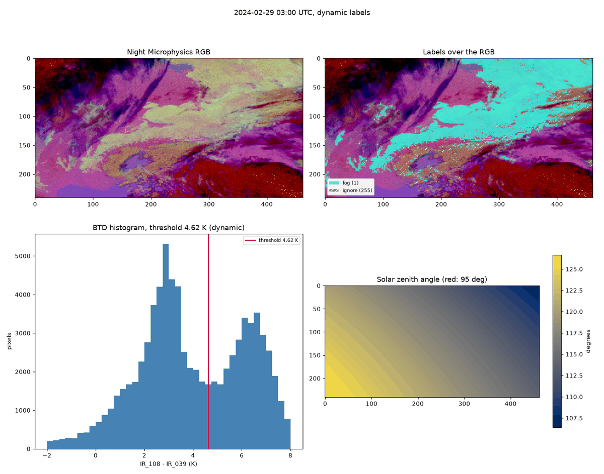
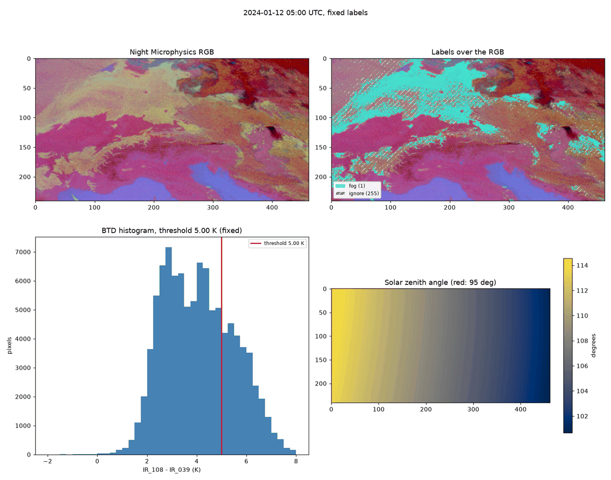
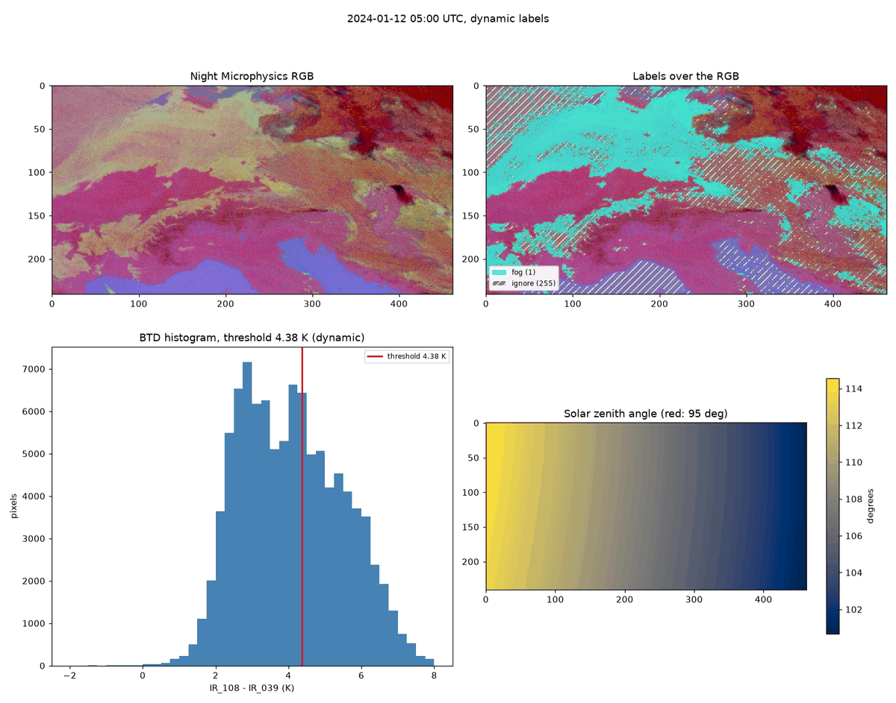
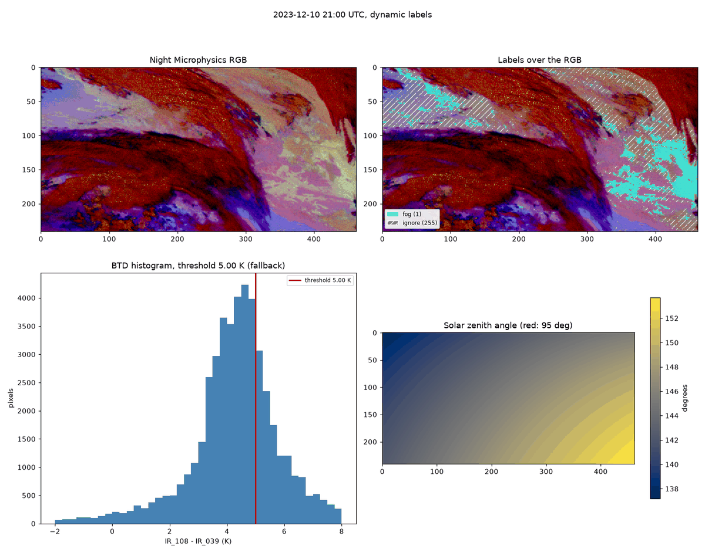
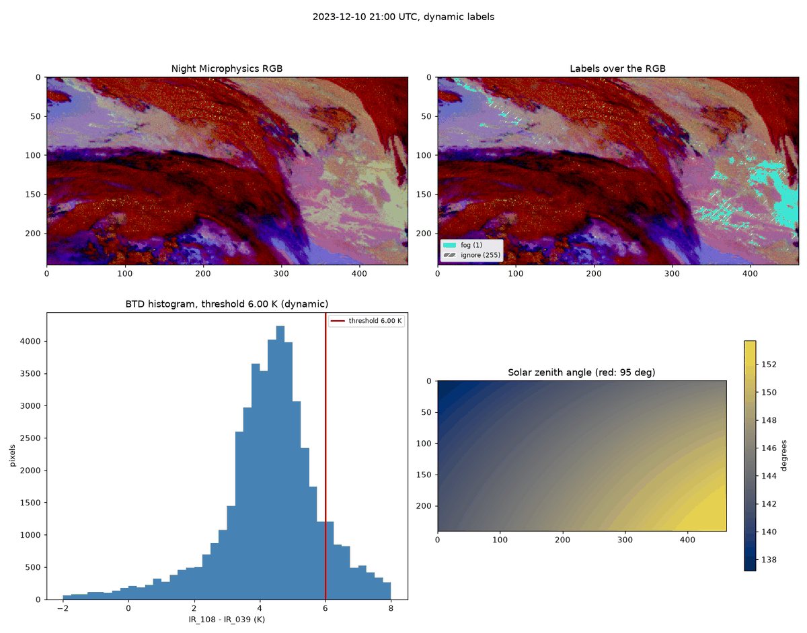
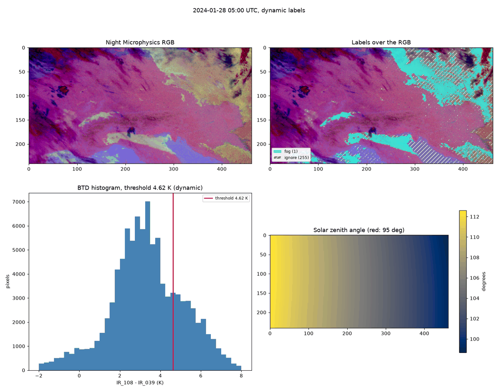
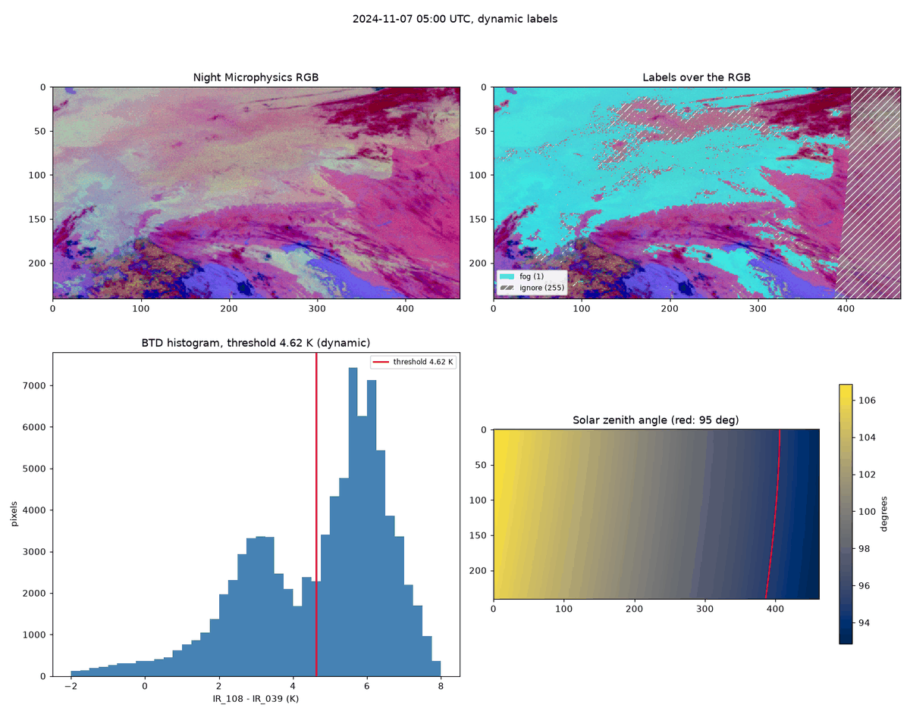

# Checking the fog labels by eye before any model sees them

Check scenes: [`configs/check_scenes.yaml`](../../configs/check_scenes.yaml) (made by `fogseg select-scenes`).
Figures: made by `fogseg inspect`; all 15 scenes in both modes are in `figures_dir` (outside the repository), the
ones discussed here are copied to [`figures/`](figures/) and shown at 1200 px wide.
Label settings: `configs/default.yaml`, section `labels`. Background: [`btd_exploration.md`](btd_exploration.md).

## Purpose

The fog labels are weak labels: they come from a threshold on the brightness temperature difference
`BTD = IR_108 - IR_039`, not from an observer on the ground. A model trained on them learns their mistakes along with
the fog. So before any model is trained, 15 scenes from the **training season 2023-24** were looked at by eye, with the
labels drawn over the Night Microphysics RGB, in both label modes (`fixed`: BTD above 5.0 K; `dynamic`: BTD above the
scene's clear-ground peak plus 1.5 K, with 5.0 K as a fallback). The question was which mode to make the default and
whether any threshold needed a change.

This is a visual check. It finds gross mistakes; it does not measure accuracy. Accuracy needs ground observations, and
those come later (METAR, see the limitations).

## How the check scenes were chosen

`fogseg select-scenes --labels dynamic` picks 15 scenes from the training season, one per night, with a fixed rule
(see `src/fogseg/check_scenes.py`), so the choice is the same every time. It uses the **dynamic** label store, so
scenes that fell back to the fixed threshold can be found too.

| Group | Scenes | Rule |
|---|---|---|
| foggy | 3 | highest fog fraction |
| clear | 3 | lowest fog fraction (ties go to the earlier scene) |
| high_cloud | 3 | largest share of night pixels colder than 240 K in `IR_108` |
| twilight | 2 | largest share of pixels with solar zenith angle at or below 95 degrees |
| fallback | 2 | first scenes where the dynamic threshold fell back to 5.0 K |
| spread | 2 | evenly spaced over the season, from the nights left |

Two consequences. The "foggy" scenes are chosen *because* the dynamic labels give a lot of fog there, so they are not
a fair sample of nights. And "clear" means "the labels found no fog", not "clear sky": two of the three clear scenes
turned out to be mostly covered by thick cold cloud (20 October, 11 February), and the third is half twilight
(8 October). They test that the labels do not invent fog, not that they work on a cloud-free scene.

## How to read an inspect figure

Each figure has four panels. North is up.

- **Top left, Night Microphysics RGB.** Fog and low cloud: pale yellow-green. Clear land: pink to lilac. Sea: blue.
  Thick high cloud: dark red. This colour key is what the labels are judged against.
- **Top right, labels over the RGB.** Cyan: fog (label 1). Hatched: ignore (255). Everything else is "not fog" (0),
  *including pixels under high cloud*.
- **Bottom left, BTD histogram** of the usable pixels (night, warm top, no thin cirrus) with the threshold as a red
  line.
- **Bottom right, solar zenith angle.** The red line is the 95 degree limit; pixels on the sunny side are ignored.

A pixel is ignored when it is too close to the sun (twilight), when a channel is missing, when its BTD lies within
0.5 K of the threshold on the fog side, or when it is in a fog patch smaller than 5 pixels. The hatching along the edges
of fog decks is the 0.5 K band.

"Fog fraction" below is the share of the *decided* pixels (label 0 or 1, not ignored) that are fog. Fog and low stratus cannot be told
apart from the satellite, so "fog" here means a low water-cloud deck that may or may not touch the ground.

## Results

| Time (UTC) | Group | Fog, fixed | Fog, dynamic | Dynamic threshold (K) | Source |
|---|---|---|---|---|---|
| 2023-10-02 05:00 | twilight | 0.029 | 0.028 | 5.12 | dynamic |
| 2023-10-04 05:00 | twilight | 0.048 | 0.029 | 5.38 | dynamic |
| 2023-10-05 21:00 | spread | 0.025 | 0.029 | 4.88 | dynamic |
| 2023-10-08 05:00 | clear | 0.000 | 0.000 | 4.62 | dynamic |
| 2023-10-20 05:00 | clear | 0.000 | 0.000 | 4.62 | dynamic |
| 2023-10-24 05:00 | high_cloud | 0.010 | 0.014 | 4.62 | dynamic |
| 2023-12-10 21:00 | fallback | 0.066 | 0.066 | 5.00 | fallback |
| 2023-12-13 03:00 | high_cloud | 0.013 | 0.004 | 5.62 | dynamic |
| 2023-12-27 03:00 | fallback | 0.061 | 0.061 | 5.00 | fallback |
| 2024-01-12 05:00 | foggy | 0.173 | 0.283 | 4.38 | dynamic |
| 2024-02-09 05:00 | high_cloud | 0.010 | 0.007 | 5.38 | dynamic |
| 2024-02-11 03:00 | clear | 0.000 | 0.000 | 5.12 | dynamic |
| 2024-02-17 05:00 | foggy | 0.151 | 0.249 | 4.38 | dynamic |
| 2024-02-26 21:00 | spread | 0.026 | 0.023 | 5.12 | dynamic |
| 2024-02-29 03:00 | foggy | 0.228 | 0.250 | 4.62 | dynamic |

The mean of the per-scene fog fractions over all 608 scenes (scenes without any decided pixel left out) is 0.0851
(fixed) and 0.0920 (dynamic). The dynamic run used the dynamic
threshold in 581 scenes and fell back in 27 (all seasons); in the training season, 293 dynamic and 11 fallback.

### What the groups show

**Foggy (29 Feb 03:00, 12 Jan 05:00, 17 Feb 05:00).** 29 February is the textbook case. The histogram has two humps,
clear ground at about 3 K and a deck at about 6.3 K, and the dynamic threshold, 4.62 K, sits in the flat valley between
them. The yellow-green deck is cyan, the pink land is not, and the only hatching is along the deck's edge. The result
on 17 February is similar (humps at about 2.8 and 5.4 K, threshold 4.38 K), with the large pale deck in the north-west
labelled almost completely. 12 January is harder: the histogram has no clean valley (see the next section).



**Clear (8 Oct, 20 Oct, 11 Feb).** No false fog. On 8 October the pink land west of the 95 degree line has a narrow
histogram at 3 K and nothing near the threshold. On 20 October and 11 February thick high cloud covers most of the
scene, no fog is labelled, and the histogram holds few pixels.

**High cloud (24 Oct, 13 Dec, 9 Feb).** The labels leave the dark red cloud alone and mark only the pale low-cloud
patches at its edge (for example the north-west of 24 October). On 13 December the threshold is 5.62 K, high for a
scene whose histogram peak is at about 4.1 K: the pale lilac deck in the west is not cyan, and the picture cannot show
whether it is a thin low deck or something higher. This is the "deck inside the clear window" risk (see limitations).

**Twilight (2 Oct, 4 Oct).** Everything east of the red 95 degree line is hatched, which is correct: BTD is not
trusted when the sun is near. Only a few small patches west of the line are labelled. The same happens on the other
scenes with a visible line (8 Oct, 20 Oct, 24 Oct, 17 Feb, 7 Nov).

**Fallback (10 Dec, 27 Dec).** The ground hump is not found inside the window (it lies at or near its upper edge,
4.75 K), so the fixed 5.0 K is used. On 27 December the core of the green deck in the south is labelled, the edges are
patchy. 10 December is discussed under the tuning steps.

**Spread (5 Oct, 26 Feb).** Mostly scattered pale patches; the labels follow the green-tinted ones. On 26 February the
large peach-coloured area in the north-west is mostly not labelled, only the greener part is.

### Fixed against dynamic

The two modes differ where the scene's own clear-ground level is far from the 5.0 K fixed value, which happens on cold
nights. The most striking case is 12 January: the clear-ground peak is at about 2.9 K, so the dynamic threshold is
4.38 K and the fog fraction rises from 0.173 to 0.283. In the fixed figure the big northern deck is full of holes (many
pixels there lie just under the 5.0 K line or in its hatched band between 5.0 and 5.5 K); in the
dynamic figure the deck is nearly closed. The same thing, smaller, on 17 February (0.151 to 0.249) and on the hero
night of 28 January (0.108 to 0.149). Where the dynamic threshold is close to 5.0 K (4.9 to 5.6 K) the two modes differ by
0.02 or less.

Two cautions. First, on 12 January the dynamic threshold does not sit in a valley; it cuts through the upper hump
(peak at about 4.2 K), so part of that hump becomes fog and part is hatched. The dynamic label there is *more
complete*, which looks right against the RGB, but it is also more dependent on one number. Second, the dynamic figure
hatches more pixels in the east and over the Adriatic, because BTD there lies in the 0.5 K band above the threshold (4.38 to 4.88 K).




## Tuning steps and decisions

**What was checked.** In 11 of the 304 training scenes the clear-ground peak was not found inside the window
`clear_window = [1.5, 4.75]` K, so they used the fixed 5.0 K. The window was widened to `[1.5, 5.0]` K in a side
experiment (outside the main label stores, so nothing was overwritten) to see what changes:

- fallbacks in the training season fall from 11 to 5;
- the 6 scenes that stop falling back get a threshold of 6.0 K, the upper clamp, because peak plus 1.5 K would be higher;
- only 8 of the 304 training thresholds change at all;
- the mean training fog fraction moves from 0.0537 to 0.0524.

**The scene that shows the trade-off: 10 December 21:00.** A mild night. The histogram has one hump whose peak is at
about 4.6 K, right at the window edge, and the fixed 5.0 K cuts through the hump. With the wider window the threshold
becomes 6.0 K. The doubtful fog in the north-west (pale lilac-grey, hardly the yellow-green of fog) disappears, which
is good, but part of the clear yellow-green deck in the east disappears too. In the default labels the eastern fog lies
over the Pannonian basin (about 19 to 22 degrees East, 45 to 50 degrees North).




**Decisions** (made with the project owner on 25 October 2026):

1. **`labels.mode` is now `dynamic`.** Reasons below.
2. **`clear_window` stays at 1.5 to 4.75 K.** The wider window changes few thresholds, and on the one scene that was
   inspected it removed good fog as well as doubtful fog. Without more evidence there is no reason to prefer it.
3. **All other values stay as they were.**

**The cost on fallback nights.** Keeping the window means mild nights still get 5.0 K, which lies only about 0.3 to
0.4 K above the ground peak there. So on fallback nights some clear ground and thin cloud may be labelled as fog (this
is what the north-west of 10 December looks like). It affects 11 of 304 training scenes (3.6 %), and these scenes get
the same label in fixed and dynamic mode, so the choice of mode does not make them worse.

## Hero nights

Two nights, each with a related independent source. For 28 January the fit between source and labels is loose (see
below); for 7 November it is good.

### Training season: 28 January 2024, 05:00 UTC

The German weather service (DWD), "Thema des Tages" of 28 January 2024 by Nico Bauer, describes the high-pressure
spell at the end of January in general terms: under persistent high pressure the weather can stay grey for days, and
fog is most persistent in wind-sheltered river valleys (Danube, parts of the Rhine) and around Lake Constance:
<https://www.wetterdienst.de/Deutschlandwetter/Thema_des_Tages/5686/der-januar-laeuft-zum-finale-zur-hochform-auf>.
It puts the high-pressure centre over southern Germany on 27 January, moving east. It does not say where fog lay on
the morning of 28 January.

Labels: fixed 0.108, dynamic 0.149 (threshold 4.62 K, dynamic). The 03:00 scene gives 0.101 and 0.137.



Where is the fog the labels found? The dataset has longitude and latitude for every pixel, so the labels can be
counted inside boxes. The boxes are rough rectangles, not country borders. The five main boxes do not overlap; the
last two lie inside the Germany box on purpose.

| Box | Longitude (E) | Latitude (N) | Fog, 28 Jan 05:00 | Fog, 7 Nov 05:00 |
|---|---|---|---|---|
| Germany | 6 to 15 | 47.5 to 55 | 0.7 % | 84.9 % |
| Poland | 15 to 24 | 49 to 54.5 | 61.8 % | 40.2 % |
| Slovakia and Hungary | 15 to 22 | 46 to 49 | 7.3 % | 13.0 % |
| Po Valley | 8 to 13 | 44.7 to 45.8 | 52.7 % | 27.7 % |
| France | 2 to 6 | 44 to 50 | 0.0 % | 66.2 % |
| Danube, southern Germany (inside Germany) | 8 to 13.5 | 47.8 to 49 | 0.0 % | 98.5 % |
| Lake Constance (inside Germany, 168 pixels) | 8.8 to 10 | 47.5 to 47.8 | 0.0 % | 100.0 % |

Each figure is the share of the decided pixels (label 0 or 1, not 255) in the box that are labelled fog. In the east
on 7 November many pixels are twilight and ignored (34 % in the Poland box, 43 % in the Slovakia and Hungary box), so
those two shares rest on fewer pixels. The numbers come from this code, which anyone with the dataset can re-run:

```python
import numpy as np
import xarray as xr

processed = "/mnt/d/fogseg-data/processed"
dataset = xr.open_zarr(f"{processed}/seviri_ceu.zarr", consolidated=False)
labels = xr.open_zarr(f"{processed}/labels_dynamic.zarr", consolidated=False)

# (lon_min, lon_max, lat_min, lat_max) in degrees; the last two boxes lie inside "Germany"
boxes = {
    "Germany": (6, 15, 47.5, 55),
    "Poland": (15, 24, 49, 54.5),
    "Slovakia and Hungary": (15, 22, 46, 49),
    "Po Valley": (8, 13, 44.7, 45.8),
    "France": (2, 6, 44, 50),
    "Danube, southern Germany": (8, 13.5, 47.8, 49),
    "Lake Constance": (8.8, 10, 47.5, 47.8),
}


def fog_share(scene_time: str, box: tuple[float, float, float, float]) -> float:
    """Share of the decided pixels (label 0 or 1) inside the box that are labelled 1."""
    lon_min, lon_max, lat_min, lat_max = box
    label = labels["label"].sel(time=np.datetime64(scene_time)).values
    lon = dataset["lon"].values
    lat = dataset["lat"].values
    in_box = (lon >= lon_min) & (lon < lon_max) & (lat >= lat_min) & (lat < lat_max)
    decided = in_box & (label != 255)
    return float((label[decided] == 1).mean())


for name, box in boxes.items():
    print(name, round(fog_share("2024-01-28T05:00", box), 3))
```

The largest connected fog area on 28 January (about 6600 pixels) covers Poland and its neighbours, from about 14 to
24 degrees East and 48.5 to about 55.4 degrees North; the next largest lies in the Po Valley.

So the picture agrees with the DWD article only loosely. Large fog or low-stratus decks are found in the east and in the
Po Valley, which fits the article's statement that the high-pressure centre moved east; that reading is my inference,
the article does not mention low cloud there. The labels do **not** show the German valley fog that the article names
(0 % in the Danube and Lake Constance boxes), and the scene should not be presented as showing it. One possible
reason is that valley fog can be narrower than a pixel (3 km at the sub-satellite point, larger here); another is that
there was none that morning. The satellite image alone cannot tell. The scene is useful as a large, plausible deck that
both modes find; the DWD article is context, not confirmation of this particular deck.

### Test season, showcase only: 7 November 2024, 05:00 UTC

This scene is from the **test season** (2024-25). It was looked at **only after all tuning decisions had been made**
and was never used to set a threshold; it is here to show how the labels behave on a hard case.

Sources: Donnerwetter.de, 7 November 2024, "Wenig Wind, Wolken und kühle Temperaturen", whose satellite caption says a
dense low-stratus deck lay over almost all of Germany that morning
(<https://www.donnerwetter.de/wetter-aktuell/wenig-wind-wolken-und-kuehle-temperaturen_cid_110468.html>); and
background on the "Dunkelflaute" of 2 to 7 November 2024 from Clean Energy Wire
(<https://www.cleanenergywire.org/news/climate-change-unlikely-increase-dunkelflaute-events-central-europe-weather-service>).

Labels: fixed 0.438, dynamic 0.500, threshold 4.62 K. In the labels 84.9 % of the decided pixels in the Germany box are
fog (98.5 % in the Danube box, see the table above), which agrees with the caption.



This is the risk from the label design where a cloud deck covers most of the scene: the deck forms its own large hump,
at 5.5 to 6.5 K and taller than the ground hump, which is at about 3 K. The ground peak was still found at the right
place, and the threshold, 3.1 K plus 1.5 K, lands near the valley (the valley minimum is at about 4.0 K, so 4.62 K
sits on the rising flank of the deck hump). The deck is labelled, so here the method was not fooled. That is one scene; it does not show the method is safe in general.

## Known limitations

- **A low-cloud deck inside the clear window.** If cloud covers most of the region and its BTD is only slightly above
  the ground, the dynamic method may take the deck for clear ground and set the threshold too high. 21 November 2023
  (00:00) is an ambiguous example: the pale decks have a BTD of only 4 to 5.5 K, the threshold is 5.38 K, and only small
  patches are labelled although much of the scene is pale cloud. 13 December may be another. There is no cloud mask to
  decide this.
- **Mild nights fall back to 5.0 K**, which sits only about 0.3 to 0.4 K above the ground there (10 December).
- **Viewing-angle drift** (+1 K from south to north, see `btd_exploration.md`): nothing obvious in the check scenes,
  for example no band of false fog on the clear land in the north, but without a cloud mask this cannot be proved.
- **Under high cloud the label is 0** (not ignore), even if fog lies below. A model trained on these labels learns that
  fog is absent under thick cloud, which is a property of the data, not of the weather.
- **Fog and low stratus look the same** from the satellite. The label means "low water cloud", not "fog on the ground".
- **Weak labels are not ground truth.** METAR observations will be used to tune and judge them later (spec, Section 7).
- **Small samples in the histogram.** On scenes covered by thick cloud the histogram holds few pixels (20 October has
  about 3000), so the peak is less certain there.

## Recommendation

Use **dynamic** as the default label mode (now set in `configs/default.yaml`).

- Where the clear-ground level is close to 5.0 K, the dynamic and fixed labels are almost the same; where it is lower
  (cold nights), the fixed threshold misses parts of the deck and the dynamic one follows the picture in the RGB
  (12 January, 28 January).
- Where it falls back (2 of the 15 check scenes, 11 of 304 training scenes), it uses the same 5.0 K as fixed mode, so
  the fallback cannot make it worse than the fixed mode.
- The costs are known: on 12 January the threshold sits inside a hump, mild nights fall back to 5.0 K, and a low deck
  inside the clear window is still a risk.

All of this evidence is from the training season. The test-season showcase scene was looked at only afterwards and is
not part of the case for dynamic labels.

Keep `clear_window` at 1.5 to 4.75 K and all other values as they are. The next check that matters is against METAR
observations, not another round of looking at pictures.

Contains modified EUMETSAT Meteosat SEVIRI data (2023-24, and 2024-25 for the showcase night)
