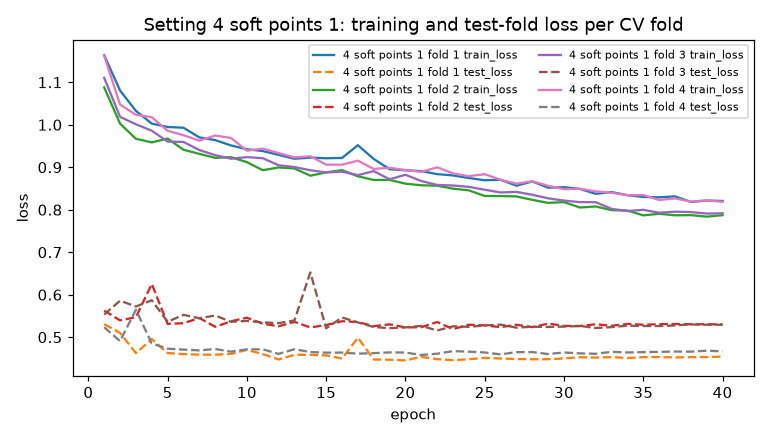
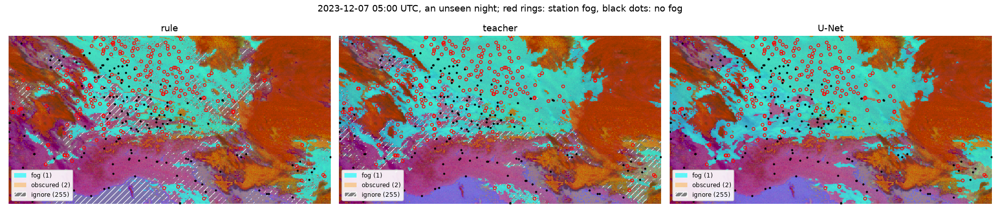
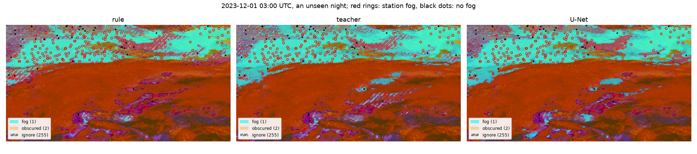

# A U-Net trained on the teacher labels

The model of [the design](../superpowers/specs/2026-11-07-unet-design.md): a small U-Net that maps one SEVIRI night
scene to a fog / low-stratus map, trained on the dense teacher labels of
[phase C](better_labels.md#phase-c-station-trained-teacher), tracked with MLflow and scored against the station truth with
the same full count, blocked folds and held-out cases as the label work.

Everything is measured on the 2023-24 training season. The 2024-25 test season was not opened.

**Result.** On the held-out cases the U-Net reaches **POD 0.865 at FAR 0.266**, against 0.769 at 0.266 for the teacher
labels and 0.433 at 0.255 for the 4.0 K rule. On stations no label, teacher or loss ever saw it reaches 0.843 at 0.264.
Most of its lead over the teacher store is the teacher's ignore band, which the full count scores as a miss: the
teacher decided at every pixel reaches 0.845 at FAR 0.302. The U-Net is still ahead of that on both POD and FAR
([below](#where-the-gain-over-the-teacher-comes-from)).

## Protocol

The rulings, with why and the cost if wrong, are in the design. In short:

- **Labels:** `labels_teacher.zarr`, now the configured labels (`labels.mode: teacher`). The rule stages (`diagnose`,
  `experiment`, `teacher`) still study the fixed rule.
- **Scenes:** the 248 scenes of the training season whose night is in night folds 1–4. Night fold 5 is never trained
  on, and the test season is never read.
- **Inputs, 14 channels per pixel:** the 8 brightness temperatures; IR10.8 − IR3.9, IR10.8 − IR12.0 and
  IR10.8 − WV6.2; terrain height; solar zenith angle; and a trusted flag. Each is standardized over the trusted pixels
  of the 248 scenes. No latitude, longitude or time.
- **Network:** a plain U-Net, depth 4, 16 channels at the top, 1.97 M weights (7.5 MB). Whole scenes, padded to
  256 × 464. Batch 4, AdamW at 1e-3 with weight decay 1e-4, cosine decay, 40 epochs. No augmentation and no early
  stopping.
- **Four loss settings:**
  - 1: binary cross-entropy against `fog_probability` / 250 ("soft");
  - 2: against `label` 0 / 1 ("hard");
  - 3 and 4: the soft loss plus 0.25 or 1.0 times the cross-entropy at the station cases of the training scenes.

  Untrusted, obscured and undefined pixels are left out of the loss, and so are station cases at such pixels: 2,000
  of the 48,669 selection cases, leaving 46,669 station points.
- **Cross-validation over the four night folds:** fold *k* trains on the other three folds and predicts the scenes of
  fold *k*. It is scored on the selection cases of fold *k*, with the full count; an untrusted or obscured case pixel
  counts as "no", as in the saved labels. p* is where the pooled FAR is highest without passing 0.28. The winner has
  the highest pooled POD.
- **Final model:** the winner's setting on all 248 scenes. Its labels are 1 where p ≥ p*, 0 below, 255 at untrusted
  pixels and 2 where the rule says obscured. There is **no ignore band**.
- **`fogseg evaluate`** scores the rule, the teacher store and the U-Net on the held-out cases once. It writes a record
  that blocks a rerun, and `fogseg train` refuses to run after it.

## Cross-validation

| Setting | p* | Pooled POD | Pooled FAR | Pooled CSI | POD per fold 1 / 2 / 3 / 4 |
|---|---|---|---|---|---|
| 1 soft | 0.48 | 0.770 | 0.277 | 0.595 | 0.720 / 0.711 / 0.832 / 0.809 |
| 2 hard | 0.77 | 0.776 | 0.280 | 0.596 | 0.725 / 0.703 / 0.841 / 0.822 |
| 3 soft + points 0.25 | 0.46 | 0.794 | 0.275 | 0.610 | 0.748 / 0.730 / 0.842 / 0.842 |
| **4 soft + points 1.0** | **0.40** | **0.821** | **0.277** | **0.624** | 0.776 / 0.749 / 0.863 / 0.880 |

- **The point loss helps in every fold, and more weight helps more.** Setting 4 beats setting 1 by 0.03 to 0.07 POD in
  each fold, at the same matched FAR. The point loss is the one place where raw station truth enters the U-Net.
- **Soft and hard targets are close** (0.770 against 0.776).
- **These scores lean optimistic and are not comparable with the teacher's CV** (0.696). p* is chosen on the rows the
  table scores. The teacher that made the labels was trained on the selection cases of every fold, including fold
  *k*'s. The table ranks the settings; the held-out table is the measurement.



The training loss includes the point term, while the test-fold loss is the pixel loss alone, so the two sit at
different levels. The test-fold loss is flat after about epoch 5 while the training loss keeps falling: the later
epochs fit the training nights and their stations more closely, without a gain in the pixel loss on new nights.
Fewer epochs might have done as well at the stations; this was not tested.

## Held-out cases

Scored once, by `fogseg evaluate` (`stations/unet_held_out.csv` and `.json`):

| Labels | Part | Cases | POD | FAR | CSI |
|---|---|---|---|---|---|
| rule, fixed 4.0 K | all held-out | 27,011 | 0.433 | 0.255 | 0.377 |
| teacher store | all held-out | 27,011 | 0.769 | 0.266 | 0.601 |
| **U-Net** | **all held-out** | 27,011 | **0.865** | **0.266** | **0.658** |
| rule | unseen nights | 9,480 | 0.485 | 0.272 | 0.410 |
| teacher store | unseen nights | 9,480 | 0.808 | 0.286 | 0.611 |
| U-Net | unseen nights | 9,480 | 0.880 | 0.265 | 0.668 |
| rule | unseen stations | 14,603 | 0.366 | 0.246 | 0.327 |
| teacher store | unseen stations | 14,603 | 0.722 | 0.250 | 0.582 |
| U-Net | unseen stations | 14,603 | 0.843 | 0.264 | 0.647 |
| rule | both unseen | 2,928 | 0.540 | 0.233 | 0.464 |
| teacher store | both unseen | 2,928 | 0.834 | 0.262 | 0.643 |
| U-Net | both unseen | 2,928 | 0.909 | 0.277 | 0.674 |

Paired bootstrap over the 14-day night blocks, all held-out cases:

| U-Net against | POD gain (95 % interval) | FAR difference (95 % interval) |
|---|---|---|
| teacher store | +0.097 (+0.067 to +0.132) | +0.000 (−0.009 to +0.018) |
| rule | +0.433 (+0.369 to +0.524) | +0.011 (−0.040 to +0.042) |

The rule and teacher rows reproduce the phase A and phase C held-out rows exactly (0.433 / 0.255 and 0.769 / 0.266), so
the scoring is the same.

### Where the gain over the teacher comes from

The U-Net has 1,145 more hits than the teacher store, and 1,180 of them sit in the teacher's ignore band, p* ± 0.1.
There the teacher writes 255, which the full count scores as a miss. Outside the band the two find the same fog reports
(264 hits the teacher misses, 299 the other way round), and the U-Net has 439 fewer false alarms. A fairer reference
is the teacher with every pixel decided at its p* = 0.41 (`docs/notes/figures/unet_figures.py`; reported after the
evaluation, not used for any choice, no interval):

| Part | U-Net POD / FAR | Teacher without its band POD / FAR | Teacher store POD / FAR |
|---|---|---|---|
| all held-out | 0.865 / 0.266 | 0.845 / 0.302 | 0.769 / 0.266 |
| unseen nights | 0.880 / 0.265 | 0.878 / 0.317 | 0.808 / 0.286 |
| unseen stations | 0.843 / 0.264 | 0.808 / 0.288 | 0.722 / 0.250 |
| both unseen | 0.909 / 0.277 | 0.896 / 0.304 | 0.834 / 0.262 |

Against the teacher decided everywhere, the U-Net has a little more POD and 0.02 to 0.05 less FAR in every part. So it
does beat its teacher, but by much less than the +0.097 against the store suggests. The bootstrap gain is a gain over
the store, which is what a user of the labels would get.

## Example maps

The two scenes of unseen nights with the most station fog reports. The U-Net map is smoother than the teacher's, follows
the same decks, and has no hatched band.





## Caveats

- **The fourth look at the held-out cases.** The label work opened them three times, so they are spent for
  choosing. Nothing was chosen after this look: setting, p* and epochs were fixed before it, and the
  band check above only reads it. The 2024-25 test season remains the clean test; it has not been opened.
- **What "unseen stations" means here.** No truth from those stations reached the teacher, the point loss or any
  choice. But the scenes of that part are training scenes: the U-Net was fitted on those images, with teacher targets
  at those pixels. Only the "both unseen" part (2,928 cases) is unseen in both images and stations.
- **Location without location inputs.** The U-Net has no latitude, longitude or time, but terrain height and the image
  itself carry geography, and the point loss used the selection stations on other nights. The unseen-nights part mixes
  in that station knowledge; the unseen-stations parts do not.
- **One season, one model.** About 60 scenes per night fold. The CV folds spread by 0.13 POD, so one season's
  held-out score is a rough measure.
- **The width was not explored here.** 16 top-level channels fit the 4 GB GTX 1050 Ti. A wider net on Colab is a
  follow-up (owner's call, 7 November 2026), [below](#a-wider-u-net-on-colab).

## A wider U-Net on Colab

[`notebooks/03_train_unet_colab.ipynb`](../../notebooks/03_train_unet_colab.ipynb) trains the same protocol with
`unet.base_channels` 32 (7.85 M weights) or 48 (17.66 M weights). What has to be on Drive, and how to copy it, is in
[the README](../../README.md#training-a-wider-u-net-on-colab). Only the width changes.

- **A wider model is compared on the CV over night folds 1–4 only**, as pooled POD at FAR ≤ 0.28, from `unet_cv.csv`.
  The notebook does not run `fogseg predict` or `fogseg evaluate`. A held-out score would be a fifth look at spent
  cases, unless the owner agrees to judge the wider model on the test season instead.
- **The test season stays closed.** Its case tables are never copied to Drive. The notebook stops if the Drive
  stations folder holds anything but `cases_fixed_2023-24.csv` and `splits_2023-24.csv`.
- **The local record is safe.** `fogseg train` refuses a stations folder with `unet_held_out.*`, so each run has its
  own stations folder on Drive, `runs/unet_base<width>/stations`, with copies of the two files and without that
  record. The folder on this machine is not touched.
- **Same inputs.** The notebook checks the sha256 of the two files and the creation time of the label store against
  the record of the 16-channel run before training.

## Reproduce

```bash
pip install -e ".[model]"
fogseg train      # 2 h 13 min on a GTX 1050 Ti, peak 6.8 GB RAM: ~30 min per setting, then the winner
fogseg predict    # 34 s, predictions_unet.zarr for the 304 scenes of 2023-24
fogseg evaluate   # once; writes stations/unet_held_out.csv and .json
python docs/notes/figures/unet_figures.py   # these figures and the band check
mlflow ui --backend-store-uri sqlite:////mnt/d/fogseg-data/mlflow/mlflow.db
```

MLflow experiment `fogseg-unet`: the `train` run `f807d393f5a44a29a2ac1336e04bd050` holds the 16 CV runs and the
`final` run `b43b9ccdbbde422ead9a0a9f511b141a`, which also holds the held-out scores. An earlier `train` run was
stopped after setting 1, before a fix that left untrusted and obscured pixels out of the point loss and the CV
scoring; its runs are marked KILLED.
