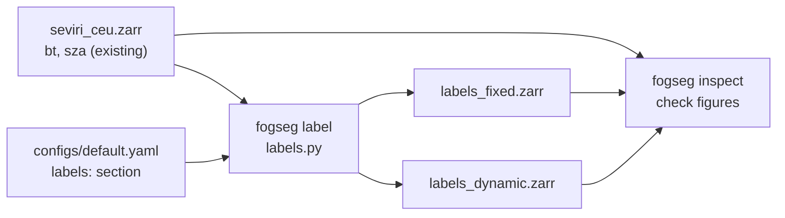
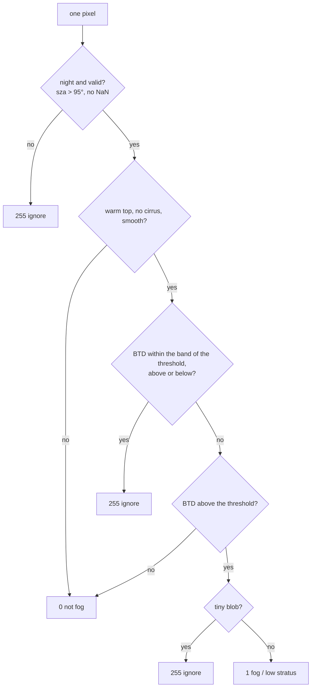

# Design: night mask and physics-based fog / low-stratus labels

Status: draft for review · Date: 2026-10-18 · Branch: `feature/fog-labels` → PR into `develop`

## 1. Goal

For every scene and pixel of the dataset (`seviri_ceu.zarr`), produce a weak label:

| Value | Meaning |
|---|---|
| `1` | fog or low stratus, visible from space |
| `0` | not fog / low stratus |
| `255` | ignore: data not trustworthy (twilight, missing values) or too uncertain to call |

The labels serve two purposes:

1. **Training targets** for the U-Net (later step); the loss skips `255`.
2. **The physics baseline** that is compared with the U-Net against airport observations (METAR).

Label `1` means "fog **or** low stratus": a geostationary satellite sees cloud tops and cannot tell
whether a low cloud touches the ground. Pixels under high cloud get `0`, although fog may hide below;
this is a documented limitation, not a bug.

## 2. Decisions taken in the brainstorming

| Topic | Decision | Reason |
|---|---|---|
| Threshold approach | **Hybrid**: a complete fixed-threshold rule first (baseline and fallback), then a dynamic per-scene BTD threshold as a switchable mode | Fixed is transparent; dynamic follows the SEVIRI literature (Cermak & Bendix 2007). Comparing both turns the choice into a measured result |
| How to judge labels before METAR | **Visual check of ~15 scenes + one hero fog night** | Cheap, reproducible, and gives the README its main figure |
| Tuning data | **Training season (2023-24) only**; the test season stays untouched | Tuning on test scenes would leak information into the evaluation |
| Where labels live | **Separate store per mode** (`labels_fixed.zarr`, `labels_dynamic.zarr`), same `time/y/x` as the dataset | Both versions side by side; relabelling never touches the 803 MB dataset |
| Thresholds | **Not fixed yet**: derived from a data exploration (Step 0) | A first look at real histograms showed clear ground near **+2 K**, not 0 K (CO₂ overlap of the 3.9 µm band), so guessed values would be wrong |
| Scope | Quality over speed; no deadline pressure for this step | The project is presented as "under development" |
| Dynamic method (after Step 0) | **Clear-ground peak + 1.5 K** per scene instead of the valley between two humps | On real data low cloud is a shoulder, not a second hump: the valley was found in 0 of 304 scenes (Section 5) |

## 3. Architecture

### 3.1 `src/fogseg/labels.py`

Two layers, so the rule can be read and tested without any file I/O:

- **Rule functions** (pure; arrays in, arrays out), one per test: night mask, invalid-data mask,
  BTD test, warm-top test, thin-cirrus test, smoothness test, uncertainty band, small-blob cleanup,
  dynamic threshold, and one function that combines them into the `0/1/255` label of a scene.
- **`label_dataset(...)`**: reads `seviri_ceu.zarr` in time batches aligned with its 8-scene chunks,
  applies the rule per scene, writes the label store. Same safety pattern as `build.py`: write to
  `<name>.zarr.part`, rename on success, delete the temporary store on any error, refuse to
  overwrite without `--overwrite`.

### 3.2 Commands

- `fogseg label --mode fixed|dynamic [--overwrite]` → writes `labels_<mode>.zarr` next to the dataset.
- `fogseg inspect --time <ISO time> --labels fixed|dynamic` → writes one check figure (Section 6.1).

### 3.3 Config: new `labels:` section in `configs/default.yaml`

All thresholds, the default mode, the dynamic-threshold settings and the output folder. Values in
this spec are **provisional starting points**; Step 0 replaces them with measured ones.

### 3.4 Label store schema

| Variable | Dimensions | Type | Content |
|---|---|---|---|
| `label` | time, y, x | `uint8` | `0`, `1` or `255` |
| `btd_threshold` | time | `float32` | BTD threshold actually used for the scene (K) |
| `threshold_source` | time | string | `fixed`, `dynamic` or `fallback` |
| `fog_fraction` | time | `float32` | share of the decided pixels (labelled 0 or 1, not 255) that are `1` |
| `ignore_fraction` | time | `float32` | share of all pixels labelled `255` |

Coordinates `time`, `y`, `x` are identical to the dataset, so `xr.merge([dataset, labels])` aligns them.
Attributes: mode, every threshold used, fogseg version, source dataset path and its `created` stamp.

## 4. The labelling rule

**Step 1, trust.** `255` if the solar zenith angle is ≤ 95° (twilight or day: reflected sunlight in
the 3.9 µm channel) or if IR_039, IR_108 or IR_120 is missing (e.g. the 1,238 invalid IR_039 values).

**Step 2, fog tests.** A night, valid pixel is a candidate only if all of these hold:

| Test | Formula | Value (measured in Step 0) | Catches |
|---|---|---|---|
| Water droplets | `IR_108 − IR_039 > T_btd` | 5.0 K (fixed) / per scene (dynamic, Section 5) | the fog signal |
| Low cloud | `IR_108 ≥ T_warm` | 255 K (260 K would drop 14 % of low cloud in Nov–Dec) | high, cold clouds |
| Not thin cirrus | `IR_108 − IR_120 < T_cirrus` | 1.5 K (2.0 K would keep 7 % of thin cirrus) | semi-transparent ice cloud |
| Smooth top | std. dev. of IR_108 in 3×3 window `< T_smooth` | 1.5 K | broken, convective cloud |

**Step 3, cleanup.**

- **Uncertainty band**: among the pixels that pass the other fog tests (warm top, no thin cirrus, smooth top),
  those with `|BTD − T_btd| < band`, **on either side** of the threshold, → `255` (band: 0.5 K). Pixels above
  `T_btd + band` are candidates; pixels below `T_btd − band` stay `0`.
- **Small blobs**: connected groups of candidate pixels smaller than `min_blob` → `255`
  (provisional: 5 pixels, ~100 km²). `255` rather than `0`, because a small blob can be real valley fog.
  The groups are counted on the candidates left after the band.

**Amended after the final review (2026-10-25, agreed with the project owner).** The band was first one-sided
(only candidates *above* the threshold became `255`), so a pixel 0.0 to 0.5 K below it received a confident `0`.
It is now symmetric. The owner also decided to keep the fixed 5.0 K as the fallback threshold, and to record as a
known limitation that on fallback nights the hump at the upper edge of the clear-ground window is usually a
low-cloud deck: the fixed 5.0 K then tends to cut through the deck (missed fog) rather than label clear ground as
fog. This was judged by eye on two scenes (3 February and 8 January 2024, 05:00); it is to be revisited with the
METAR tuning (Section 7). See `docs/notes/label_check.md`.

**Step 4.** Everything else that is night and valid → `0`.

Rationale for using `255` generously: with weak labels it is better not to teach the model than to teach
it something possibly wrong.

## 5. Dynamic BTD threshold

Per scene:

1. **Histogram pixels**: night, valid, warm (`IR_108 ≥ T_warm`) and not thin cirrus, so the histogram
   contains clear ground and low cloud only.
2. **Histogram** of BTD in fixed bins (0.25 K from −2 to +8 K), lightly smoothed (3 bins).
3. **Clear-ground peak**: the highest bin of the smoothed histogram inside the clear-ground window
   (1.5 to 4.75 K).
4. **Threshold** = clear-ground peak + offset (1.5 K).

**Amended after Step 0 (2026-10-19, agreed with the project owner).** The first design looked for the
valley between a clear-ground hump and a low-cloud hump. On the 304 training-season scenes, low cloud
almost never forms a second hump: it is a shoulder on the clear-ground hump. The valley method found a
valley in **0 of 304** scenes. The clear-ground peak, however, is found in 303 of 304 scenes, and where a
valley does exist it lies 1.5 K above that peak (middle half 1.5–1.75 K). The peak moves between scenes
(1.9–4.6 K), so measuring from it follows the scene the way the valley was meant to. Evidence:
`notebooks/02_explore_btd.ipynb`, `docs/notes/btd_exploration.md`.

**Safeguards**; if any fails, the scene uses the fixed threshold (`threshold_source = fallback`):

| Condition | Value |
|---|---|
| Enough histogram pixels | ≥ 2,000 |
| A real peak | the highest bin is not on the edge of the clear-ground window |
| Plausible result | clamped to 3.5–6.0 K |

**Not in scope now**: separate thresholds per satellite viewing-angle band (Cermak & Bendix). Step 0
found a clear-ground drift of about +1 K from 54° to 65° viewing angle, but viewing angle and latitude
are almost the same thing in our region (correlation 0.96). The check scenes (Section 6.2) decide whether
a viewing-angle correction is needed; until then a too-low margin in the north mostly produces `255`
(uncertainty band), not false fog.

## 6. Exploration and checking

### 6.0 Step 0: explore the BTD distributions (before fixing any threshold)

Notebook `notebooks/02_explore_btd.ipynb`, **training season only**:

- BTD histograms next to the Night Microphysics RGB for varied scenes, with clear and cloudy areas
  identified in the RGB.
- Where the clear-ground and low-cloud humps sit, and how the clear-ground level changes with satellite
  viewing angle, month and time of night.
- Output: the provisional values in Sections 4 and 5 replaced by measured ones, each backed by a figure.

### 6.1 `fogseg inspect` figure (per scene)

| Panel | Content |
|---|---|
| 1 | Night Microphysics RGB (EUMETSAT recipe, satpy `night_microphysics` equivalent) |
| 2 | Labels over the RGB: `1` in cyan, `255` hatched grey |
| 3 | BTD histogram with the threshold used and its source (fixed / dynamic / fallback) |
| 4 | Solar zenith angle with the 95° contour |

Figures are written to `<data>/figures/inspect/` (not tracked by git); selected ones are copied into `docs/`.

### 6.2 Check scenes and hero night

- ~15 **check scenes from the training season**, chosen by a script from per-scene statistics (not by hand)
  and saved as a list in the repo: 3 very foggy, 3 nearly clear, 3 dominated by high cloud, 2 twilight
  (05:00 in early October / late February), 2 dynamic-threshold fallbacks, spread October → February.
- **Hero night**: a well-documented fog event (DWD reports, news) on one of our nights, preferably in
  2023-24. A test-season event (candidate: 10 Nov 2024, the November 2024 "Dunkelflaute", to be verified)
  may be used as a README showcase only, never for tuning.

## 7. Planned extension: tuning against training-season stations

After the METAR step exists: tune the thresholds objectively against **training-season (2023-24)**
station observations (POD / FAR / CSI), and use **test-season (2024-25)** stations only once, for the
final evaluation. Benchmark from the literature: FogPy / DWD, SYNOP visibility < 1 km, ~400 scenes:
POD 71–74 %, FAR 15 % (low cloud), 34 % (ground fog). Not part of this PR.

## 8. Testing (synthetic data only, runs in CI)

| Unit | Cases |
|---|---|
| Trust masks | daytime pixel → 255; missing IR_039 → 255 |
| Fog tests | warm + high BTD → 1; cold → 0; thin cirrus → 0; rough top → 0 |
| Uncertainty band | BTD just above or just below the threshold → 255 (cold top just below → 0) |
| Blob cleanup | 3-pixel island → 255; 10-pixel deck stays 1 |
| Dynamic threshold | clear-ground hump → peak + offset; peak on the window edge or too few pixels → fallback; extreme value → clamped |
| Label store | shape, `uint8`, metadata with all thresholds, overwrite refusal, no `.part` left after an error, `xr.merge` with the dataset aligns |

## 9. Error handling

- Dataset missing or without `bt` / `sza` → clear error naming the expected path.
- Label store exists and no `--overwrite` → refuse.
- A scene with no night pixels (all `255`) is valid output, not an error.
- `inspect` with a time not in the dataset → error listing the nearest available times.

## 10. Documentation deliverables

- Dataset card: label statistics per mode (fog and ignore fractions, dynamic vs fallback counts).
- `docs/explainers/` (separate small step right after this spec, requested during brainstorming): one page
  per topic (fog physics, sun angle, Zarr and chunks, how the code works, the labelling rule) containing
  the visuals from the design conversation: flowcharts as Mermaid, illustrations as SVG files with a white
  background, interactive ones as a static snapshot plus the HTML file, real-data figures as PNG with
  EUMETSAT attribution.

## 11. Order of work

| # | Work | Result |
|---|---|---|
| 0 | Explore BTD distributions (training season) | `02_explore_btd.ipynb`, measured thresholds |
| 1 | Fixed rule, label store, `fogseg label --mode fixed` | first labels |
| 2 | `fogseg inspect`, check-scene list | visual check, tuned thresholds |
| 3 | Dynamic threshold, `--mode dynamic` | second label version |
| 4 | Fixed vs dynamic on the check scenes; hero night | comparison figures, recommendation |
| 5 | Dataset card, README | documentation |

Small reviewed commits; one PR into `develop`.

## 12. Risks and open questions

- **Clear-ground BTD offset** (~+2 K in a first look): its cause (CO₂ overlap of the 3.9 µm band, viewing
  angle) and its variability decide whether a fixed threshold can work at all. Step 0 answers this.
- **Scenes fully covered by low cloud** (no clear-ground hump, e.g. 10 Nov 2024) fall back to the fixed
  threshold by design. Risk of the peak + offset method: a deck of low cloud with a BTD inside the
  clear-ground window (seen on 21 Nov 2023 at 4–5.5 K) could be taken for the ground peak, pushing the
  threshold above the fog. The window's upper edge (4.75 K) and the clamp limit this; the check scenes
  must show whether it happens.
- **Snow-covered ground** can mimic low cloud in some tests; to be watched in the check scenes.
- **Absolute warm-top threshold** may be too strict in cold air masses; Step 0 checks low-cloud tops by month.

## 13. References

- Cermak, J. & Bendix, J. (2007): Dynamical nighttime fog/low stratus detection based on Meteosat SEVIRI
  data: a feasibility study. *Pure and Applied Geophysics* 164, 1179–1192.
- Leppelt, T., Asmus, J., Hungershöfer, K. (2018): SEVIRI fog and low cloud detection at DWD, adapted
  from SOFOS. EUMETSAT Meteorological Satellite Conference:
  https://www-cdn.eumetsat.int/files/2020-04/pdf_conf_2018_s2_leppelt_o.pdf
- FogPy (pytroll): https://github.com/pytroll/fogpy, https://fogpy.readthedocs.io/
- FogPy validation against SYNOP visibility (POD / FAR figures quoted in Section 7):
  https://egusphere.copernicus.org/preprints/2024/egusphere-2023-2885/egusphere-2023-2885-AC1-supplement.pdf
- EUMeTrain, Night Microphysics RGB: https://resources.eumetrain.org/data/4/410/print_4.htm
