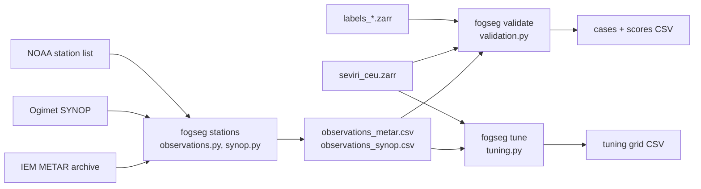

# Design: checking and tuning the fog labels against station observations

Status: draft for review · Date: 2026-10-28 · Branch: `claude/metar-validation-419635` → PR into
`feature/fog-labels` (until PR #3 is merged into `develop`)

## 1. Goal

The fog labels (`labels_fixed.zarr`, `labels_dynamic.zarr`) come from brightness-temperature thresholds, not from
observers. This step brings in observers on the ground, as planned in Section 7 of
`2026-10-18-fog-labels-design.md`:

1. **Score** both label stores against airport and weather-station observations with POD, FAR and CSI.
2. **Tune** `labels.dynamic.offset` (now 1.5 K) and the fallback threshold `labels.btd_fixed` (now 5.0 K) objectively,
   on **training-season (2023-24) stations only**.
3. **Report honestly** where the labels fail: fallback scenes with a deck at the window edge, the north-south drift of
   the clear-ground BTD (about +1 K), and fog hidden under high cloud (label 0).

The test season (2024-25) is scored **once**, after all values are frozen.

## 2. Decisions taken in the brainstorming

| Topic | Decision | Reason |
|---|---|---|
| Observation sources | **METAR and SYNOP** | METAR gives exact cloud bases at airports; SYNOP adds rural and valley stations and is the source of the FogPy benchmark |
| Truth rule | **FLS rule of Egli et al. (2017) / Jahani et al. (2025)** (Section 4) | Label 1 means "fog or low stratus"; a fog-only truth would count every correctly found stratus deck as a false alarm. Published for SEVIRI over Europe, so the scores are comparable |
| Second view | **Fog only** (visibility < 1 km) also scored | Comparable with the FogPy / DWD SYNOP benchmark |
| Fog under high cloud | **Left out of the tuning, reported separately** | No BTD threshold can find it; Jahani et al. (2025) drop these "multi-layer" cases from training too |
| What may be tuned | **`dynamic.offset` and `btd_fixed`** | The two values the label check left open. The north-south drift is measured and reported, not corrected |
| When a value changes | **Only if a paired bootstrap of the CSI difference excludes 0** | No change without evidence |
| Architecture | **Three commands with files in between** (download, validate, tune) | Downloads happen once; scoring and tuning can be rerun offline |

Both technical choices without a clear user preference (truth rule, tuning scope) were taken on the recommendation
above; the project owner agreed to the design on 2026-10-28.

## 3. Architecture

### 3.1 Modules

| Module | Job |
|---|---|
| `observations.py` | Station lists, downloads (IEM, Ogimet), turning both sources into one observation table |
| `metar.py` | Pure METAR decoding: prevailing visibility and the ceiling, from the raw message |
| `synop.py` | Pure SYNOP decoding of the groups needed: `iRiXhVV`, `Nddff`, `8NhCLCMCH` |
| `scores.py` | Contingency table, POD / FAR / CSI / bias, bootstrap over nights, paired bootstrap |
| `validation.py` | Truth rule, station-to-pixel and observation-to-scene matching, the case table, the score table |
| `tuning.py` | Re-labels the training scenes for a grid of thresholds and scores each grid value |

Pure functions (decoding, truth, matching, scores) are separated from file and network I/O, as in `labels.py`, so
the tests need no network and no real data.

### 3.2 Commands

- `fogseg stations [--source metar|synop]` downloads and parses the observations of all dataset nights (both
  seasons). Resumable: raw downloads are kept per request in `stations.raw_dir`, and a request whose file exists is
  not repeated. Writes `observations_<source>.csv`.
- `fogseg validate --labels fixed|dynamic --season 2023-24` matches observations to the label store and writes the
  matched cases and the score table. **The test season is refused unless `--final` is given.**
- `fogseg tune` scores the threshold grid on the training season (the season name is read from the config, not
  from the command line, so the test season cannot be chosen). Writes the grid scores and logs the recommended
  values. It does **not** edit the config: values are changed by hand, with the evidence in the notes.

### 3.3 Config: new `stations:` section in `configs/default.yaml`

Data folder (`/mnt/d/fogseg-data/stations`), IEM networks and WMO blocks to fetch, the Ogimet window length and
pause, the station limits (distance to pixel, elevation), the truth thresholds, the time tolerance, the scan delay, the latitude bands,
the tuning grids, the number of bootstrap samples and the random seed. The training season is named here
(`tune_season: "2023-24"`); the test season is the other one in `time.seasons`.

## 4. Observations and truth

### 4.1 Sources

| Source | Where | Content used | Notes |
|---|---|---|---|
| METAR | Iowa Environmental Mesonet (IEM) `asos.py`, one request per station and season | Raw METAR, decoded by `metar.py`: prevailing visibility in m and cloud layers. IEM's own decoded visibility is in miles, so 1000 m would come back as 998 m and fall on the wrong side of the limit | Station coordinates and elevation from the IEM network files (`<CC>__ASOS`) |
| SYNOP | Ogimet `getsynop`, one request per WMO block and dataset night (20:00 to 06:00 UTC) | Raw `AAXX` messages, decoded by `synop.py` | Ogimet answers too large or too frequent requests with an empty body (a week of block 10 came back empty, three days did not): a pause between requests; an empty answer is retried after a longer pause and, if it stays empty, not saved, so the next run asks again |
| SYNOP stations | NOAA `isd-history.csv` | WMO id, latitude, longitude, elevation | Only needed for SYNOP |

No API keys are involved. Raw files and tables live in the data folder, outside the repository.

Only observations within the night windows are kept (from 20:00 to 06:00 UTC around each dataset night), so the
tables stay small.

### 4.2 Stations

A station is used when its nearest pixel centre is at most **5 km** away (this drops stations outside the cropped
grid) and its elevation is at most **1000 m**: a mountain station reports "fog" whenever it is inside a cloud, which
the satellite sees as a mid-level cloud top.

### 4.3 Truth rule (per observation)

| Truth | METAR | SYNOP |
|---|---|---|
| **FLS** | visibility < 1000 m, **or** a BKN / OVC layer with base < 1000 m, **or** vertical visibility (`VV`) < 1000 m | VV code < 1000 m, **or** low-cloud amount `Nh` > 5 oktas with base code `h` ≤ 5 (< 1000 m), **or** sky obscured (`N = 9`) |
| **No FLS** | visibility and cloud layers known, and none of the above | the same |
| **Undefined** | visibility missing, or cloud layers missing (auto `///`) while visibility ≥ 1000 m | the same; `Nh` from the `8` group, total cover `N` if the group is absent |

- "Cover > 5 oktas" is the published criterion. METAR `BKN` covers 5–7 oktas, so it is the closest METAR category;
  SYNOP gives oktas and uses > 5 exactly.
- SYNOP `h` is the base of the lowest cloud of any amount, `Nh` the amount of the low clouds. Together they are the
  usual approximation of "a low deck covers the sky".
- `CAVOK` and `NSC` / `NCD` mean no cloud below 5000 ft: cloud part "no".
- **Fog only** (second view): visibility < 1000 m.

### 4.4 Matching

- **Pixel**: the nearest pixel centre on the dataset's `lon` / `lat` grid (great-circle distance).
- **Time**: SEVIRI scans from south to north; Central Europe is scanned about **12 minutes after** the nominal slot
  time. Each scene takes, per station, the observation closest to nominal time + 12 min, within **± 30 min**;
  none in that window → no case.
- **One case per pixel and scene**: when METAR and SYNOP stations fall on the same pixel at the same scene, the
  pooled score keeps the METAR case (exact cloud base). Each source is also scored on its own.

### 4.5 Cases that are not scored as hit / miss

- **Label 255** at the station pixel (twilight, missing channels, uncertainty band, small blob): no score. The number
  of FLS and no-FLS cases that end up as 255 is reported, because a label that ignores most fog is not good, even
  when its POD on the rest is high.
- **Hidden by high cloud**: the station pixel has `IR_108 < warm_min_bt108` or `IR_108 − IR_120 ≥ cirrus_max_split`
  (the labels' own tests). These cases are kept in the case table with the flag `hidden`, scored in an "all cases"
  view, and **left out of the tuning objective**. The number of FLS cases that are hidden is the size of the
  "fog under cirrus" limitation.

## 5. Scores

From the contingency table of label (1 / 0) against truth (FLS / no FLS):

| Score | Formula |
|---|---|
| POD | hits / (hits + misses) |
| FAR | false alarms / (hits + false alarms) |
| CSI | hits / (hits + misses + false alarms) |
| Frequency bias | (hits + false alarms) / (hits + misses) |

**Uncertainty**: 95 % bootstrap interval, resampling **whole nights** (cases on one night are not independent),
1000 samples, fixed seed.

**Breakdowns** in the score table: label mode; source (METAR, SYNOP, pooled); truth (FLS, fog only); hidden cases
in or out; threshold source of the scene (dynamic, fallback); latitude band (43–47, 47–51, 51–56 °N, for the drift);
slot (21, 00, 03, 05 UTC).

**Benchmarks** quoted next to the results, not used for any decision: FogPy / DWD against SYNOP visibility < 1 km
(POD 71–74 %, FAR 15 % low cloud, 34 % ground fog); Jahani et al. (2025), METAR FLS over Europe, test set:
POD 0.82, FAR 0.31, CSI 0.60.

## 6. Tuning (training season only)

1. For every training scene, compute the clear-ground peak once (`clear_ground_peak`) and read the scene's
   channels once.
2. For each grid value, set the scene's threshold:
   - `offset` grid 0.5 to 3.0 K in 0.25 K steps: `clip(peak + offset, clamp)` on scenes with a peak; the current
     fallback on the others.
   - `btd_fixed` grid 4.0 to 7.0 K in 0.25 K steps: on fallback scenes (dynamic mode) and on all scenes (fixed mode).
3. Label the whole scene with `label_scene` (the blob cleanup needs the whole scene) and read the labels at the
   matched station pixels.
4. Score each grid value on the pooled FLS truth, hidden cases left out.

**Objective**: CSI. **Decision**: the best grid value replaces the current one only when the 95 % paired bootstrap
interval (same resampled nights for both values) of `CSI(best) − CSI(current)` excludes 0. Otherwise the current value
stays and the notes say so. `offset` is decided first, then `btd_fixed` with the chosen offset; the fixed mode's
`btd_fixed` is reported but the dynamic mode's fallback decides the config value.

The `btd_fixed` grid rests on the training fallback scenes only (11 of 304), so its interval will be wide; the notes
say how many cases it rests on.

After the decision: the label stores are rebuilt with `fogseg label --overwrite`, validation is rerun on the training
season, and then, **once**, on the test season with `--final`.

## 7. Failure reporting (notes page)

| Limitation | How it is measured |
|---|---|
| Fallback scenes, deck at the window edge | Scores of fallback scenes against dynamic scenes; the `btd_fixed` grid |
| North-south drift (+1 K) | POD, FAR per latitude band; false alarms on clear-sky "no" cases in the north |
| Fog under high cloud | Share of FLS cases flagged `hidden`; scores with and without them |
| Ignored fog | Share of FLS cases labelled 255, by reason where it can be told (twilight, band, blob) |

## 8. Error handling

- No observation table → error naming the file and the command that writes it.
- Network failure or empty answer → retry with a pause; after the last try, the request is logged as failed and
  the run continues (the next run fetches it again).
- A season name not in `time.seasons` → error listing the names.
- Test season without `--final` → refuse, with a message pointing to this spec.
- A station with no case at all → listed in the log, not an error.

## 9. Testing (synthetic data only, runs in CI)

| Unit | Cases |
|---|---|
| SYNOP decoding | visibility codes (00–50, 56–80, 90–99), `h`, `N = 9`, `8` group present / absent, `///` values |
| METAR rows | miles → m, BKN / OVC / VV / FEW layers, CAVOK, missing values |
| Truth rule | 999 m / 1000 m edges, FEW against BKN, low base with small cover, undefined cases |
| Matching | nearest pixel on a small grid, station too far dropped, closest observation in ±30 min, none in window |
| Scores | POD / FAR / CSI / bias on a hand-made table; empty table gives NaN, not an error |
| Bootstrap | resamples whole nights; same seed gives the same interval |
| Test-season guard | `validate` on the test season without `--final` raises |
| Tuning | a synthetic scene set with fog planted above a known BTD: the grid finds that offset |

## 10. Documentation deliverables

- `docs/notes/station_validation.md`: data, truth rule, matching, all scores with intervals, the tuning grids, the
  decision on each value, the failure analysis of Section 7, and the final test-season scores.
- `configs/default.yaml`: `stations:` section; tuned values with a comment pointing to the notes.
- README: the validation step and its headline scores. Dataset card: the station validation and its limits.

## 11. Order of work

| # | Work | Result |
|---|---|---|
| 1 | `synop.py`, METAR row decoding, truth rule (pure, tested) | decoders |
| 2 | Station lists and downloads, `fogseg stations` | observation tables |
| 3 | Matching, scores, bootstrap, `fogseg validate` | scores of the current labels |
| 4 | `tuning.py`, `fogseg tune` | grid, decision |
| 5 | Relabel, rescore training, then the one test-season run | final scores |
| 6 | Notes, config, README, dataset card | documentation |

## 12. Risks and open questions

- **Ogimet limits** are not documented; the window and pause are config values, and the download is resumable.
- **Airports are not random places**: they avoid valleys, so valley fog is under-sampled; SYNOP helps a little.
- **Pixel size** (a few kilometres, larger towards the north) against a point observation: patchy fog makes misses and false alarms that
  are nobody's fault. Not corrected; stated in the notes.
- **Few fallback scenes**: the `btd_fixed` decision may well be "keep 5.0 K, not enough evidence".

## 13. References

- Egli, S., Thies, B., Drönner, J., Cermak, J., Bendix, J. (2017): A 10 year fog and low stratus climatology for
  Europe based on Meteosat Second Generation data. *Q. J. R. Meteorol. Soc.* 143, 530–541.
- Jahani, B., Karalus, S., Fuchs, J., Zech, T., Zara, M., Cermak, J. (2025): Algorithm for continual monitoring of
  fog based on geostationary satellite imagery. *Atmos. Meas. Tech.* 18, 1927:
  https://amt.copernicus.org/articles/18/1927/2025/
- Cermak, J. & Bendix, J. (2008): A novel approach to fog/low stratus detection using Meteosat 8 data.
  *Atmos. Res.* 87, 279–292.
- FogPy validation against SYNOP visibility: see Section 13 of `2026-10-18-fog-labels-design.md`.
- Iowa Environmental Mesonet ASOS/METAR archive: https://mesonet.agron.iastate.edu/request/download.phtml
- Ogimet SYNOP archive: https://www.ogimet.com/
- NOAA Integrated Surface Database station history: https://www.ncei.noaa.gov/pub/data/noaa/isd-history.csv
- WMO Manual on Codes (WMO-No. 306), FM 12 SYNOP and FM 15 METAR.
